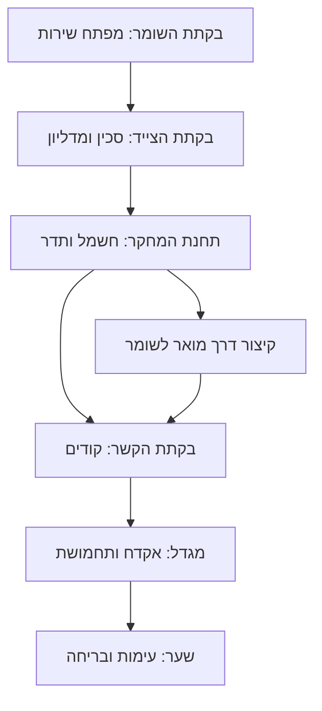

# עד האור האחרון — אפיון משחק ומדריך מימוש ל־GPT-6

> **עדכון מימוש וחוקים — 0.5.0, 08.10.2026:** בעקבות הבקשה האחרונה הוחלפו ארבע הגופות במודלים אנטומיים של MakeHuman עם טקסטורות עור, שיער ובגדים, פציעות ודם. נוספו חמישה זאבים נגועים עם שלד ואנימציות, וגרזן ליד גופת המודד הקרובה לבקתה: E לאיסוף ולחצן עכבר שמאלי לתקיפה; שתי פגיעות הורגות זאב. נוספו צעדים לפי תנועה ומשטח, נשימה לפי מאמץ, צעקה מוקלטת, דם על המסך ותפריט מוות. המפלצת חוזרת מנקודות מרוחקות עם נתיב הגעה, בלי להשתגר מול השחקן, ונקישות ההליכה נשמעות רק בזמן תנועה. קובצי המקור והרישיונות מתועדים ב־[Docs/CombatAndCharacters.md](Docs/CombatAndCharacters.md).

> **שינוי מפורש לעומת חוקי האפיון המקורי:** בתוך רדיוס אופקי של 2.8 מטרים הפנס אינו הודף את המפלצת ואינו מבטל את התקיפה. תקיפה מלאה של המפלצת קטלנית גם במפגש הראשון; אין עוד תלות באיסוף נתיך או בהשלמת לימוד הפנס. קירות ומחסות ענבריים עדיין מגינים, והנורה בתחנת המחקר אינה מגינה. הגרזן פוגע בזאבים בלבד. הנפות הגרזן דורשות טווח, כיוון וקו פגיעה פנוי. גרזן וזאבים מתים נשמרים בנקודות השמירה; שמירות ישנות עוברות לגרסה 3. כללי שינוי אלה קודמים לסעיפי ההגנה והמפגש הראשון במסמך המקורי. העדכונים הבאים מתארים גרסאות קודמות.

**שם עבודה באנגלית:** Until the Last Light  
**גרסה:** 1.0 — אפיון לפיתוח  
**תאריך:** 2026-10-08  
**פלטפורמת יעד:** Windows, שחקן יחיד, ללא צורך בחיבור לרשת  
**כלי עבודה:** Unity, C#, URP, Blender, Python ליצירת נכסים  
**החלטות שאושרו:** משחק של 60–90 דקות; ריאליסטי מסוגנן; קושי מאוזן.

> זהו מסמך תכנון, לא פרויקט שכבר נבנה או נבדק במנוע. ערכי האיזון והביצועים הם נקודת התחלה לבדיקה. כיוון המשחק והחוקים המרכזיים מחייבים; ערכים מספריים מסומנים כנתוני כוונון. להתחיל באבטיפוס משחקי, ולא בבניית כל התוכן במקביל.

> **מצב המימוש — 08.10.2026, גרסה 0.4.0:** קיים אבטיפוס יער מורחב ב־Unity עם 24 נכסי Blender מקוריים, 12 ערכות PBR, רמות פירוט, תאורה וערפל נע וצפוף. המפלצת נבנתה מחדש לפי תמונת הייחוס עם שלד ואנימציות זחילה ומנוחה. נוספו קולות טבע ליליים וארבע גופות בדמויות אנושיות מפורטות. 41 בדיקות אוטומטיות ובדיקת הסצנה המורחבת עברו, נבדקו צילומי Unity ורצף אנימציה, ונבנתה גרסת Windows מעודכנת. המסלול המלא, יתר הבקתות, המגדל, P01–P05, האקדח והעימות האחרון עדיין חסרים; משך המשחק ויעדי הביצועים לא אומתו. פירוט המימוש והפערים נמצא ב־[Docs/Progress.md](Docs/Progress.md), הוראות הפעלה ב־[Docs/QuickStart.md](Docs/QuickStart.md), ותוצאות בדיקה ב־[Docs/TestReport.md](Docs/TestReport.md).

> **אווירת לילה וגופות אנושיות — גרסה 0.4.0:** נוספו צרצרים בסטריאו, קריאות ינשופים וציפורי לילה, צפרדעים ורשרוש עלים, עם מיקומים משתנים ותזמון לא קבוע. קולות הטבע עמומים יותר בתוך מבנים ונחלשים ליד המפלצת כדי לשמור על שמיעת האזהרות. ערפל אפור צפוף ושכבות אדים נעות באוויר ובקרקע מצמצמים את הראות; הערפל והשמע נעצרים בתפריטים. ארבע הגופות נבנו מחדש ב־Blender עם פנים רציפות, עפעפיים סגורים, אוזניים, אף, שפתיים, שיער, כפות ידיים ואצבעות, בגדים, מגפיים ותיקי מסמכים. נוספו חומרי בד ועור ורמות פירוט למרחק. המסמכים והמפה נשארו מחוברים לגופות. אלה דמויות משחק מקוריות וקולות מסונתזים; תיעוד המימוש וקובצי המקור ב־[Docs/AtmosphereAndBodies.md](Docs/AtmosphereAndBodies.md).

> **עדכון המפלצת בעקבות תמונת המשתמש — גרסה 0.3:** גוף אנושי מעוות בזחילה נמוכה, עור חיוור עם ורידים וקמטים, שמונה גפיים בשרניות ומפרקיות ושתי כפות ידיים קדמיות עם אצבעות. הראש חסר עיניים ואף ובתוכו חלל פה עם שיניים, חניכיים, לשון ורוק. ב־Blender נוצר שלד בן 28 עצמות ואנימציות זחילה ומנוחה, שחוברו ב־Unity למהירות התנועה. הצמדת כפות לקרקע ותיקון מול קירות נוספו, והפה נפער לפי הקרבה. המודל הוא פרשנות משחקית לתמונה. פירוט וקובצי המקור ב־[Docs/CreatureArt.md](Docs/CreatureArt.md).

> **שיפור עור המפלצת — גרסה 0.3.1:** נוספה טקסטורת עור אנושי מקורית שנוצרה ב־imagegen, עם נקבוביות, שינויי פיגמנט ונימים עדינים. צבע העור נאפה ב־Blender לאטלס גוף של 4096 פיקסלים, כדי לצמצם תפרים, ומפות נקבוביות וחספוס של 2048 פיקסלים נוספו. חומר העור ב־Unity כולל ברק מתון ופיזור אור חמים ועדין עם הצללה, ונבדק בתאורה רכה ובפנס ביער. המקור שנוצר הוא 1254 פיקסלים; אין מדובר בסריקת עור אמיתית. השלד, הזחילה והפה נשארו מחוברים. תיעוד ומקור הטקסטורה ב־[Docs/CreatureArt.md](Docs/CreatureArt.md).

> **עדכון בעקבות בקשת המשתמש — גרסת אבטיפוס 0.2:** השטח המשחקי הורחב ל־280×280 מטר. המפלצת כעת חצי אנושית וחצי עכביש, ללא עיניים או אף, עם שמונה רגליים ופה מלא שיניים שנפער לפי הקרבה. נוספו ארבע גופות עם מסמכים, מפה שנמצאת אצל המודד, תחנת מחקר עם שלושה חדרים ומסדרון ומנורה חלשה שאינה מגינה, נקישות, שמע מתח לפי קרבה ויללות זאב מדי פעם. המשחק תומך בעברית ובאנגלית, כולל ממשק, מסמכים, שילוט ומפה. בחירת השפה נשמרת. שינויים אלה מעדכנים את תיאור המפלצת וזמינות המפה באפיון המקורי. 33 בדיקות אוטומטיות ובדיקת הסצנה המורחבת עברו; הדוח המעודכן נמצא ב־[Docs/Progress.md](Docs/Progress.md). הקמפיין המלא ויעדי הביצועים עדיין לא הושלמו.

## תוכן העניינים

1. הנחיות עבודה ל־GPT-6
2. חזון, גבולות ועקרונות
3. סיפור וחוויית השחקן
4. עולם, מסלול וקצב
5. שליטה ותנועה
6. הפנס ומודל ההגנה מאור
7. התנהגות המפלצת
8. אימה דינמית, ערפל ועצים
9. חפצים ותיק
10. חידות ותלות בין משימות
11. סיום, נשק וניצחון
12. ממשק, נגישות ושמירה
13. סאונד ועיצוב חזותי
14. ארכיטקטורת Unity
15. צינור נכסים ב־Blender
16. תקציבי ביצועים
17. אבטיפוס ושלבי פיתוח
18. בדיקות וקבלה
19. סיכונים והחלטות יישום
20. פרומפט פתיחה ונספחי נתונים

## 1. הנחיות עבודה ל־GPT-6

התפקיד שלך הוא לממש משחק שניתן לפתוח, להריץ, לבדוק ולבנות. קוד C# לבדו אינו תוצר שלם: יש לספק סצנות, Prefabs, הגדרות, נכסים וחיבורי מערכות בפועל.

1. בדוק את סביבת העבודה, הוראות הפרויקט, גרסאות Unity/Blender ויכולת הרצת Editor/Batch Mode. תעד מה זמין ומה חסר בלי להניח התקנות או גישה לכלים.
2. אם קיים פרויקט, קרא אותו ושמור על גרסתו ועל מזהי נכסיו. אם אין פרויקט, צור פרויקט URP בגרסת Unity 6 LTS נתמכת שנבחרה וננעלה בתחילת העבודה.
3. התחל ב־M0 וב־M1 שבסעיף 17. בנה קודם סצנת בדיקה עם צורות פשוטות. שפר את האמנות רק לאחר אימות חוקי האור והתנועה.
4. השתמש בקוד Editor כדי ליצור ולחבר סצנות ו־Prefabs באופן שחזורי. אין להמציא GUIDs או לערוך YAML של סצנות באופן עיוור.
5. השתמש בנתונים ניתנים לכוונון עבור סוללה, מרחקים, AI, חידות וקושי. אין לפזר מספרי איזון בתוך סקריפטים.
6. הבחן בין "נכתב", "התקמפל", "הורץ ב־Editor", "נבדק במשחק" ו"נבנה ונבדק ב־Windows". אל תדווח על שלב שלא בוצע.
7. כשאין Unity/Blender זמין, עדיין צור את הקוד, הנתונים וסקריפטי הבנייה שאפשר להכין, אך ציין במדויק אילו בדיקות והפקות ממתינות לסביבה מתאימה.
8. בכל אבן דרך עדכן `Docs/Progress.md` עם תוצרים, פקודות הרצה, תוצאות בדיקה, מגבלות והמשימה הבאה. אין חובה לייצר את כל המשחק בתגובה אחת.
9. שמור יצירה מקורית. אין להשתמש בדמות, לוגו, מפה, סאונד או מודלים מועתקים ממשחק Slender. ההשראה היא סוג החוויה.
10. הכרעות יישום שגרתיות אינן דורשות עצירה. שינוי בחוקי המפלצת, משך המשחק, הסגנון או מסלול הסיום דורש הצגה למשתמש לפני שינוי האפיון.

## 2. חזון, גבולות ועקרונות

משחק אימה בגוף ראשון ביער לילי. ישות גבוהה וחסרת פנים עוקבת אחר השחקן בחושך. פנס ידני הוא גם כלי חקירה וגם הגנה כיוונית. ככל שהסוללה נחלשת, גבול ההגנה מתקרב; ככל שהישות קרובה, הערפל מתעבה, העצים מתעוותים והסאונד שלה מתחזק.

השחקן נע בין בקתות, מפענח תיעוד של שומרי היער, משיג כלים, מפעיל תחנת מחקר וקשר, מוצא אקדח במגדל ולבסוף הורג את הישות ובורח דרך שער היער.

**לולאת המשחק:** זיהוי יעד באמצעות רמז → הליכה וחקירה → קריאת סימני סכנה → שימוש באור/בריחה → מציאת כלי או פתרון חידה → פתיחת דרך → הפוגה במקום מואר.

### 2.1 עקרונות מחייבים

- אימה נובעת מנוכחות, רמזים ותגובות עקביות. התקפה אינה תוצאה של טלפורט מפתיע ליד השחקן.
- אור חזק מגן בכיוון האלומה; הצדדים והגב נשארים חשופים.
- המפלצת אינה עוברת דרך קיר, דלת סגורה או אזור מוגן מאור.
- אור ירח, מסך UI וחומרים זוהרים קישוטיים אינם מגינים. מקורות הגנה מוגדרים במפורש ומלמדים את השחקן לזהות אותם.
- השחקן יכול להציל את עצמו לאחר אזהרה. אין מוות מיידי ללא אות מקדים והזדמנות תגובה.
- המסלול, חפצי המשימה ופתרונות החידות קבועים. ניתן לגוון אירועי אווירה ומקומות מעקב.
- שינויי עצים הם חזותיים בלבד בגרסה הראשונה. שבילים, קוליידרים וציוני דרך מרכזיים נשארים יציבים.
- ניהול משאבים יוצר מתח, אך אינו מחייב התחלה מחדש בגלל מחסור בלתי פתיר.

### 2.2 היקף גרסה 1.0

| כלול | נדחה לגרסה עתידית |
| --- | --- |
| יער אחד, ארבע בקתות, מגדל ושער | עולם פתוח גדול או מפת עולם אקראית |
| מפלצת אחת עם מערכת מצבים | אויבים נוספים, קרבות רגילים לאורך המשחק |
| פנס, סוללות, סכין, מפתחות ונתיכים | Crafting, רעב, צמא או מערכת משקל |
| חמש חידות עיקריות ותוכן צד קטן | עשרות חידות או סופים מסתעפים |
| שמירה בנקודות מוגדרות | Multiplayer, VR או שירות ענן |
| אקדח רק בסיום | מערכת כלי נשק רחבה |
| תמיכה במקלדת ועכבר | תמיכה מלאה בבקרים ובקונסולות |

יעד הזמן הוא זמן משחק ראשון של שחקן חדש, כולל חקירה והפוגות. אין לכפות המתנות כדי להגיע ל־60 דקות. מסלול של שחקן שמכיר את החידות יהיה קצר יותר.

## 3. סיפור וחוויית השחקן

### 3.1 הנחת הסיפור

השחקן הוא מטייל שאיבד את השביל לפני רדת החשכה. הוא מתעורר ליד בקתת שומר ביער שפונה לפני שנים בעקבות היעלמויות. בתיקו פנס, סוללות חלופיות ופתק שהושאר בכניסה: "האור עוצר אותו. אבל רק במקום שבו האור נוגע."

הישות מכונה בתיעוד **"ההולך"**. חוקרים מצאו שנוכחותה מעוותת את תפיסת היער. שומר אחרון ניסה להוביל אנשים החוצה, אך נעל את הנשק במגדל והשאיר מסלול רמזים כדי שלא יילקח בידי מי שאינו מבין את הסכנה.

### 3.2 מידע שנחשף בהדרגה

| שלב | גילוי | השלכה משחקית |
| --- | --- | --- |
| בקתת השומר | אור ישיר עוצר; הגב אינו מוגן | הדרכת פנס וכיוון סאונד |
| בקתת הצייד | השבילים החסומים מסתירים דרך לתחנה | שימוש בסכין וקיצור דרך |
| תחנת המחקר | שינויים ביער משקפים קרבה; לא כל אור הוא הגנה | הכרת Dread ותאורת מקלט |
| בקתת הקשר | שער יציאה פעיל, קוד פתיחה ונשק במגדל | סימון היעדים האחרונים |
| מגדל | מקרוב ובחושך הישות מתגשמת ויכולה להיפגע | הכנה לעימות האחרון |

הסיפור מועבר בפתקים, הקלטות קצרות ופרטי סביבה. אין צורך בדמויות מדברות או בסרטונים ארוכים. לכל הקלטה כתוביות ותמליל נגיש ביומן. מידע חיוני לא נשען על שמיעת משפט חד־פעמי.

### 3.3 מסמכים עיקריים

- `note_guard_rules`: חוקי האור, רמז לארונית.
- `note_hunter_route`: סימון גשר השירות והחבל החוסם.
- `note_research_power`: הוראות חשמל ברורות ותצלום לוח הנתיכים.
- `recording_research`: הקשר בין קרבה לערפל, והאזהרה שהאור אינו מגן מאחור.
- `recording_radio`: מיקום המגדל, קוד שער ותדר החירום.
- `note_last_watch`: קוד כספת, תצפית על התגשמות בטווח קרוב והוראות העימות.

מסמכי האפיון מגדירים תוכן נדרש; את הניסוח הספרותי המלא יש לכתוב כחלק מ־M3, באורך שאינו מעכב משחק. שפת המשחק הראשונית: אנגלית, עם טבלת מחרוזות ומבנה המאפשר עברית בהמשך. אין לחסום אבטיפוס על מערכת RTL; תמיכה בעברית תיבדק בנפרד לפני הצגתה כמושלמת.

## 4. עולם, מסלול וקצב

### 4.1 מבנה המפה

יער בנוי מראש, בגודל התחלתי של כ־450×450 מטר. מדובר בשטח מעטפת, לא בצורך למלא כל מטר בתוכן. מסלול החובה הכולל, עם פיתולים וביקור חוזר, כ־1.8–2.4 ק"מ. יעדים סמוכים מופרדים בדרך כלל ב־120–220 מטר הליכה.

המפה נראית פתוחה, אך סלעים, מדרונות, גדרות ועצים מכוונים לשבילים. מחוץ למסלול יש כיסי חקירה קצרים; לא שדות ענק ללא משמעות. לכל אזור לפחות שתי אפשרויות תנועה מקומיות כדי לאפשר איגוף ובריחה. את מסלול החובה אפשר לסיים ללא ביקור בכיסי הצד.

| אזור | זמן יעד | תפקיד | נקודת שמירה |
| --- | --- | --- | --- |
| בקתת השומר והסביבה | 8–12 דקות | לימוד, מפה, מפתח | בכניסה ולאחר פתיחת הארונית |
| הדרך ובקתת הצייד | 10–14 | מפגש ראשון לא קטלני, סכין, רמז | לאחר איסוף סכין ומדליון |
| תחנת המחקר | 14–18 | חיפוש נתיכים, חשמל, הקלטה | לאחר הפעלת התחנה |
| הדרך ובקתת הקשר | 10–14 | מתח גבוה, כיוון רדיו | לאחר קליטת ההודעה |
| מגדל ותצפית | 10–14 | כספת, נשק, הבנת סיום | לאחר פתיחת הכספת |
| דרך לשער ועימות | 8–12 | הכנה, קרב ובריחה | לפני תחילת הקרב |

טווחי השלבים מסתכמים ב־60–84 דקות. יתרת מרווח היעד מוקדשת לסטיות קצרות וחיפוש. המגדל אינו מוסיף טיפוס ממושך לצורך מילוי זמן.

### 4.2 תלות בין אזורים



לכל מקום ציון דרך ברור: עששית השומר, אנטנות תחנת המחקר, תורן בקתת הקשר, מגדל מעל צמרות וגדר שער. מפת נייר נרכשת בהתחלה, ללא GPS; ביומן מסומן היעד האחרון הידוע.

### 4.3 מקלטים ומסלולי גיבוי

- בקתת השומר מוארת תמיד; אור מגן מכסה את הפנים ורצועה קטנה לפני הדלת.
- בקתת הצייד חשוכה ואינה מקלט עד להפעלת עששית קבועה בפעולת אינטראקציה אחת, ללא משאב מתכלה.
- תחנת המחקר נעשית מקלט לאחר תיקון החשמל. התאורה אינה נכבית מחדש אחרי הפתרון.
- בבקתת הקשר קיימת מנורת מקלט עצמאית, ללא קשר לחידת הרדיו.
- במגדל ובמבואת השער יש אור קבוע. זירת העימות עצמה חשוכה.
- כל מעבר חובה של יותר מ־90 שניות הליכה כולל בדרך כיס אור אחד או מסלול חזרה ברור למקלט. נקודות האור מסומנות במפה ואינן מופיעות אקראית.
- מקור מילוי חירום לסוללה נמצא בכל מקלט; הוא מונע תקיעה אך אינו מאפשר להישאר בטוח במהלך חיפוש בחוץ.

## 5. שליטה ותנועה

| פעולה | ברירת מחדל |
| --- | --- |
| תנועה / מבט | WASD / עכבר |
| ריצה | Shift בהחזקה |
| התכופפות | Ctrl, אפשרות להחזקה או Toggle |
| אינטראקציה | E |
| פנס | F |
| אלומה מוגברת | לחצן עכבר ימני, לפני השגת הנשק |
| תיק | Tab |
| מפה ויומן | M / J |
| החלפת סוללה | R כשאין נשק מצויד |
| ציוד פנס / אקדח | 1 / 2, לאחר רכישת נשק |
| ירי / כיוון | עכבר שמאלי / ימני כאשר האקדח מצויד |
| טעינת אקדח | R כאשר האקדח מצויד |
| השהיה | Esc |

עם אקדח מצויד אפשר להחזיק את הפנס ביד השנייה ולהדליקו ב־F. אין אלומה מוגברת בזמן כיוון האקדח. גם בזמן נשיאת האקדח אפשר להחליף סוללה מתוך התיק, כשהמשחק מושהה.

### 5.1 ערכי בסיס לכוונון

| פרמטר | ערך התחלתי |
| --- | --- |
| הליכה / ריצה / כריעה | 3.0 / 5.2 / 1.6 מטר לשנייה |
| ריצה רציפה | 8 שניות |
| המתנה להתאוששות / מילוי stamina | 1.5 / 5 שניות |
| גובה מצלמה בעמידה / כריעה | 1.7 / 1.15 מטר |
| טווח אינטראקציה | 2.2 מטר, עם בדיקת קו ראייה |
| FOV | ברירת מחדל 80 מעלות אנכיות, טווח 60–95 |
| קפיצה | ללא קפיצה חופשית; מעבר מכשולים נמוכים מסומן |

התנועה מבוססת `CharacterController`, עם כבידה ובדיקת קרקע. אין דרישת גוף מלא בגרסה הראשונה; דרושים ידיים, פנס וידיים עם אקדח בסיום. תנועת המצלמה עדינה וניתנת לביטול.

אין קרב סכין: הסכין היא כלי לפתיחת מעברים. אין להתחבא בארונות כמערכת נוספת. כריעה מפחיתה רעש אך אינה הופכת את השחקן לבלתי נראה.

## 6. הפנס ומודל ההגנה מאור

### 6.1 מקור אמת אחד

`FlashlightModel` מחשב סוללה, מצב, טווח, זווית ומקדם עוצמה. ממנו ניזונים גם התאורה החזותית וגם `LightProtectionService`. אין מערכת AI שמנחשת הגנה מתוך בהירות המסך או רינדור.

נסמן `b = charge / 100`, בתחום 0–1. כשהפנס פועל וסוללתו מעל 0:

```text
protectRange = 6.5 + 11.5 * sqrt(b)          // מטרים: 6.5–18
outerHalfAngle = 24 degrees                // זווית מלאה 48
innerHalfAngle = 18 degrees                // אזור הגנה מלאה
visualIntensityFactor = 0.35 + 0.65 * b
normalDrain = 100 / 420 per second          // 7 דקות של אור רגיל
boostDrain = normalDrain * 3
boostProtectRange = protectRange * 1.25
```

ב־0% או כשהפנס כבוי אין הגנה. אלומה מוגברת זמינה עד 3 שניות רצופות, עם 5 שניות התאוששות; היא מרחיקה את המפלצת אך יקרה בסוללה. טווח וזווית מוצגים ב־Gizmos לצורך בדיקה, לא ב־HUD המשחק.

### 6.2 בדיקת אור גאומטרית

נקודה מוגנת רק כאשר היא בטווח, בזווית האלומה, וה־Raycast ממקור האור אינו נחסם. דלת/קיר/גזע אטום חוסמים; חלקיקי ערפל וענפי נוי אינם קוליידרים להגנה.

המפלצת מיוצגת בקפסולה. בודקים ראש, חזה ובסיס, ובגבולות האלומה גם שולי הקפסולה. מסלול התנועה נבדק בדגימות לאורך המקטע, ברווחים של עד חצי רדיוס הקפסולה; לא רק ביעד. כך אי אפשר לרוץ דרך אלומה בין שני פריימים. אלומת הפנס החזותית אינה יכולה להראות אור מגן דרך קיר.

**הגנה מלאה:** בתוך הטווח ו־innerHalfAngle, עם קו ראייה לחזה או לראש. המפלצת עוצרת מיד את ההתקדמות אל השחקן ואז נסוגה.

**שפת האלומה:** בין 18 ל־24 מעלות, או ברצועה של 1 מטר סביב גבול הטווח. המפלצת יכולה להיראות ולעקוב לאורך הגבול. היא אינה חוצה את האזור המלא ואינה תוקפת דרך שפת האור כאשר קפסולת ההתקפה מוגנת.

**חושך:** מחוץ להגנה, או מאחורי מכשול. מותר להתקרב, כולל מאחור ומהצדדים.

מקורות אור קבועים משתמשים באותו שירות, עם נפח כדורי/תיבה מוגדר ובדיקת חסימה. איחוד של מקורות מגן; כיבוי הפנס אינו מבטל אור מקלט. תאורה חזותית זוהרת או תאורת ירח אינה נרשמת בשירות.

### 6.3 תגובה להארה ולשינוי מצב

- אור ישיר מפסיק תנועה פנימה באותו עדכון הגנה. אנימציית הרתיעה מתחילה בתוך 0.15 שניות; אין חלון שבו מותר להמשיך לתקוף רק בגלל אנימציה.
- אם האלומה מסובבת על המפלצת, מותר לה להיות מוארת לרגע ולסגת. אסור לה להיעלם מיד רק משום שהשחקן ראה אותה.
- המפלצת אינה מבצעת תקיפה מתוך נפח מוגן, גם אם התקיפה הוכנה קודם. בדיקה נוספת מתרחשת בעת אישור הפגיעה.
- אם הפנס מסתובב והמפלצת כבר נמצאת בתוך אור, מותרת רק תנועת יציאה מוגבלת: כל צעד מקטין חשיפה ואינו מקרב אותה לשחקן. בדיקת "חציית אור" חייבת להבחין בין כניסה אסורה לבין נסיגה מתוך תאורה קיימת; אחרת הישות תיתקע במקום. אם אין נתיב יציאה כזה היא קופאת, ללא תקיפה, עד שהאלומה זזה.
- בעת תקיפה בודקים את קפסולת המפלצת ואת מוצא/מקטע המכה מול האלומה, ואת מיקום השחקן מול מקלטים קבועים. אין לבדוק רק את נקודת מקור הפנס שעל השחקן: בדיקה כזו עלולה להחשיב אותו למוגן מכל כיוון.
- מעבר סוללה מ־1% ל־0% מלווה ברמז; תגובת ציד מתחילה אחרי 1.2 שניות חסד. החסד אינו חוזר בכל Toggle של הפנס; חידושו דורש לפחות 5 שניות הגנה רציפה.
- אפקט הבהוב מתחת ל־15% הוא חזותי עדין בלבד. הוא אינו מבטל את ההגנה בפריימים אקראיים.
- ערפל חוסם ראייה אסתטית אך אינו מקצר בסתר את טווח ההגנה. אם בעתיד ישפיע עליו, השינוי חייב להופיע גם במודל ובבדיקות.

### 6.4 סוללות ומניעת תקיעה

סוללה חלופית מחליפה את הטעינה ל־100%; יתרת הסוללה הישנה אובדת. פעולה ב־R נמשכת 2.5 שניות בזמן משחק; בהתחלה הפנס נכבה, נשמע קליק ובסיום הוא חוזר למצב הקודם. בתיק המושהה ההחלפה מתבצעת אטומית.

השחקן מתחיל עם פנס מלא ושתי סוללות חלופיות. בכל מקלט אפשר לבצע טעינת חירום חינם ל־35% במשך 12 שניות, ורק אם הטעינה נמוכה מ־35%. הפעולה אינה יוצרת סוללות בתיק ואינה מצטברת מעבר ל־35%. המקלט עצמו מגן במהלך הפעולה. אפשר לבטל ולנסות שוב; טעינה מתקבלת רק בהשלמה.

חלוקת חובה: 2 סוללות נוספות בשומר, 2 בצייד, 3 במחקר, 2 בקשר ו־2 במגדל. יחד עם התא הראשוני ושתי הסוללות ההתחלתיות מתקבלים 14 תאים מלאים, כ־98 דקות אור רגיל. אור אינו נצרך כשמשחק מושהה. עד 3 סוללות צד נוספות אפשריות. מלאי בודד מוגבל ל־6, ולכן ערימות שנשארו בעולם ממשיכות להיות נגישות בביקור חוזר.

זהו תקציב נדיב בכוונה לאבטיפוס מאוזן. יש למדוד שימוש אמיתי באלומה מוגברת, הליכה והפוגות לפני הקטנתו. אחרי נקודת השמירה במגדל ניתן לחזור למקלטים עד הפעלת העימות.

## 7. התנהגות המפלצת

### 7.1 הופעה, חושים ותנועה

מפלצת אחת בלבד פעילה. היא מופיעה לראשונה לאחר הדרכת הפנס, במרחק 35–50 מטר על NavMesh תקין, מחוץ לשדה הראייה או מאחורי מכשול אטום. אין הופעה בתוך מקלט או בתוך אלומת אור. לאחר הופעה היא נעה ברציפות בעולם.

הופעה מחדש מותרת רק אחרי טעינת שמירה או מעבר מוסדר בין סצנות; זו אינה טקטיקת AI. אם המפלצת נתקעת, היא בוחרת מסלול אחר או ממתינה. אין Warp ליד השחקן, אין מעבר דרך קירות ואין היעלמות מול מצלמה.

| חוש | נתון התחלתי | התנהגות |
| --- | --- | --- |
| ראייה | 45 מטר, קו ראייה | זיכרון מיקום אחרון ל־8 שניות |
| שמיעת הליכה | 10 מטר | פנייה למקור הרעש |
| שמיעת ריצה | 24 מטר | חקירה מהירה |
| רעש גנרטור/ירי | 45 מטר | התקרבות למקור, בכפוף להגנה |
| מכוון מתח | מכיר אזור כללי בלבד | יכול לבחור נקודת מעקב סמוכה, לא לתקוף דרך מידע נסתר |

ה־Director יודע מרחק לצורך אווירה, אבל ה־AI אינו משתמש במיקום המדויק של השחקן לאחר אובדן ראייה/רעש. הוא מחפש סביב המיקום האחרון. יעד בנתיב חייב להיות נגיש ואינו מאפשר התקרבות בניגוד לאור.

### 7.2 מצבים

| מצב | כניסה | פעולה | יציאה |
| --- | --- | --- | --- |
| `Dormant` | התחלה או ללא יעד | לא מאיימת | סיום הדרכה |
| `Watching` | שחקן באור/לאחר הפוגה | צופה בנקודה רחוקה, 20–40 מטר | חלון חשוך ומידע חושי |
| `Stalking` | שחקן בתנועה | מחפשת מסלול חשוך לצד/גב, 8–25 מטר | הזדמנות התקרבות או הארה |
| `Approaching` | נתיב חשוך ושחקן מזוהה | מתקרבת בהליכה, אזהרות ברורות | אור ישיר/אובדן יעד/טווח ציד |
| `Hunting` | יעד בחושך וסכנה גבוהה | ציד מוגבל בזמן; ריצה בנתיב חוקי | אור, מקלט, אובדן יעד או timeout |
| `AttackWindup` | יעד עד 1.8 מטר, לא מוגן | צליל ותנועה של 1.2 שניות | התקפה או ביטול מיידי בגלל אור/מרחק |
| `Repelled` | אור מגן או פגיעה | נסיגה לנקודה חוקית בלי טלפורט | חסד ואז Watching/Stalking |
| `Dead` | שלוש פגיעות מאושרות בסיום | נפילה, סיום איום | נשארת במצב סופי |

ערכי התחלה: מעקב 1.8 מ'/ש', התקרבות 2.8, ציד 4.5, נסיגה 4.0. מהירות ריצת שחקן גבוהה מציד; stamina והנתיב מייצרים את האתגר. ציד רגיל נמשך לכל היותר 10 שניות, ולאחר אובדן יעד המפלצת מחפשת ולא רצה לעבר מיקום נסתר.

סדר קדימויות: `Dead` → מקלט/אור → ביטול התקפה → תגובה לפגיעה → חושים ומצבי ציד → בחירת מתח. אירוע מתוסרט ו־Director אינם עוקפים את סדר הקדימויות.

### 7.3 תקיפה מאוזנת

- מגע אינו גורם למוות אוטומטי. נדרש Windup, קו ראייה, מרחק מותר והיעדר הגנה לאורך אישור התקיפה.
- שחקן מקבל מצב `Wounded` בפגיעה הראשונה, עם נשימה וטשטוש קל. אין הפחתת מהירות שמונעת בריחה.
- לאחר פגיעה: 6 שניות חסינות והשבתה זמנית של תוקפנות המפלצת; היא נסוגה בנתיב חוקי. אין שתי פגיעות באותה אנימציה.
- פגיעה נוספת לפני התאוששות גורמת למוות וטעינת נקודת שמירה. 15 שניות רצופות במקלט מסירות Wounded.
- אזהרת נשימה כיוונית מתחילה עד 8 מטר. היא חייבת להישמע לפחות 1.5 שניות לפני Windup ראשון בכל מפגש.
- אין תקיפה קטלנית במפגש ההדרכה הראשון. אם השחקן מתעלם מההנחיה, המפלצת נעצרת בטווח מוגדר וההדרכה חוזרת.

### 7.4 מציאת נתיבים שאינם חוצים אור

NavMesh רגיל מחשב נגישות גאומטרית בלבד; הוא אינו פותר לבד מכשול דינמי בצורת אלומת פנס. יש להוסיף שכבת החלטה:

1. בחר 8–12 מועמדים סביב השחקן/המיקום האחרון: שפת אור, צדדים, מכשולים ונקודות Watch מוגדרות.
2. סנן נקודות שאינן על NavMesh, מוגנות או מובילות למקלט.
3. חשב נתיב NavMesh למועמד, וסרוק את המקטעים מול הגנה. נתיב קצר שעובר באור אינו חוקי.
4. דרג נתיבים חוקיים לפי חשיפה, עלות, מרחק וזווית לשחקן; הוסף וריאציה מוגבלת מ־seed מתועד.
5. אם אין נתיב חוקי, הישאר/נסוג. אין לחצות אור כדי "לתקן" חוסר נתיב.
6. באבטיפוס, הוסף Waypoints משני צדי מכשולים ושבילים כדי לאפשר איגוף. רק אם הוכח צורך, הרחב לרשת A* מקומית שמסננת אור.
7. לפני כל צעד תנועה, בדוק שוב הגנה לאורך המקטע. החלטה ישנה של מתכנן הנתיב אינה גוברת על פנס שהסתובב כעת.

תכנון מחדש 4 פעמים בשנייה; בדיקת הצעד והתקפה בכל עדכון תנועה. רוטציית המפלצת ואנימציות מציגות את התנועה האמיתית; אין Root Motion שמחליק דרך מחסום הגנה.

### 7.5 Director והסלמה

אחרי מפגש מסוכן: 35–60 שניות של הפוגה מתוקפנות יזומה. השחקן עדיין יכול להיכנס במכוון למגע עם הישות; ההפוגה אינה בלתי מנוצחות. בשומר ובמפגש ראשון: מעקב בלבד. אחרי צייד: התקרבות מותרת. אחרי מחקר: ציד קצר. אחרי קשר: איגוף תכוף יותר. בסיום: חוקי הקרב המוגדרים בסעיף 11.

אירועי אווירה מקבלים cooldown של 90–150 שניות; לכל אירוע משמעותי יש הגבלת הופעות. אין לבצע Jumpscare בזמן תפריט, הקלטה מושהית או מקלט. אירועי דמות מזויפת לא יחקו את אזהרת התקיפה האמיתית באופן שמבטל את אמינותה.

## 8. אימה דינמית, ערפל ועצים

מדד `Dread` נסתר בתחום 0–1. הוא נגזר בעיקר ממרחק פיזי למפלצת, ולא משמש להענקת סמכות התקפה. כך ערפל גבוה לא גורם ל־AI לצוד ואז לציד להגביר שוב ערפל ללא גבול.

```text
proximity = 1 - smoothstep(4, 32, monsterDistance)
batteryStress = flashlightOn ? (1 - batteryFraction) : 1
stateStress = Hunting ? 1 : Approaching ? 0.5 : 0
targetDread = clamp01(0.70*proximity + 0.15*batteryStress
                     + 0.10*stateStress + 0.05*storyStress)
if no active living monster: targetDread = 0
```

החלקה בזמן: עלייה כ־2 שניות, ירידה כ־6 שניות. במקלט הדגש החזותי יורד עד 0.2; סאונד חיצוני יכול להמשיך להעיד שהמפלצת בחוץ. אחרי מותה המדד יורד ל־0, ללא תלות במרחק לגופה.

| Dread | ערפל | עצים | סאונד/מצלמה |
| --- | --- | --- | --- |
| 0–0.25 | בסיס קל | צורה רגילה, רוח איטית | יער טבעי |
| 0.25–0.50 | עיבוי מתון | ענפים מתכופפים בהדרגה | חריקות, שכבת drone חלשה |
| 0.50–0.75 | ערפל ניכר | צלליות ענפים דמויות אצבעות | נשימות וכיוון צעדים ברורים |
| 0.75–1.00 | כבד אך מסלול עדיין קריא | עיוות מירבי מוגבל | דופק וטשטוש עדין, אזהרת סכנה |

### 8.1 מימוש חזותי ישים ב־URP

בחר URP לאורך הפרויקט. אין להניח ש־Volume רגיל נותן את ערפל HDRP. עבור האבטיפוס השתמש בערפל מרחק/גובה פשוט בשיידר מתאים ושכבות חלקיקי ערפל מקומיות. אם נדרש ערפל נפחי אמיתי, זו משימת Renderer Feature נפרדת עם תקציב ביצועים ובדיקות, לא תנאי למשחק עובד.

הערפל מדגיש שכבות מרחק. עד 6 מטר מהשחקן נשמרת קריאות מספקת לשביל ולחפץ. החשיפה קבועה/מוגבלת: אין Auto Exposure שמאיר את כל היער כשהפנס נכבה. אלומת אור נראית באמצעות קונוס VFX זול, בלי להעניק הגנה נוספת.

### 8.2 עצים משתנים

- עצי Hero הקרובים: Mesh עם שני Blend Shapes, `Dread_Stage1` ו־`Dread_Stage2`, או Mesh חלופי עקבי עבור אותה צללית.
- עצים רבים ורחוקים: Shader Graph עם עיוות vertex קל ומסכת גובה. כל רמות ה־LOD שומרות על אותה משפחת צללית.
- ה־Collider, מיקום הגזע ו־NavMesh נשארים ללא שינוי. העיוות מוגבל לענפים ולצמרת ואינו חוסם ויזואלית שביל שהקוליידר מאפשר לעבור בו.
- לא להפעיל Physics או שינוי Mesh ב־CPU על מאות עצים בכל פריים. השתמש בפרמטר גלובלי ובשונות קטנה לכל מופע.
- שינויים במראה לאחר הסתובבות אפשריים רק בעצים קישוטיים מחוץ לפריים; אינם יוצרים/מוחקים דרך חובה.
- לכל שיידר עיוות, Shadow/Depth passes ועיוות ה־LOD חייבים להתאים. לעדכן bounds כדי שהצמרת לא תיעלם עקב culling.

## 9. חפצים ותיק

התיק הוא UI עם שישה תאים לציוד מתכלה. חפצי משימה, פנס, סכין, מפה, אקדח ומסמכים נמצאים באזור ציוד קבוע/משימות ואינם מתחרים על התאים. אין זריקה או אובדן של חפץ חובה.

| ID | חפץ | אחסון | שימוש |
| --- | --- | --- | --- |
| `gear_flashlight` | פנס | ציוד קבוע | תאורה והגנה |
| `cons_battery` | סוללה | תא אחד, stack עד 6 | מילוי ל־100% |
| `gear_knife` | סכין | ציוד קבוע | חיתוך חסימה מסומנת |
| `quest_service_key` | מפתח שירות | משימה | שער הדרך לצייד |
| `quest_hunter_medallion` | מדליון עם הספרות 42 | משימה | רמז כספת |
| `quest_fuse_a/b/c` | שלושה נתיכים | משימה | לוח תחנת המחקר |
| `quest_tower_key` | מפתח מגדל | משימה | דלת מגדל |
| `gear_revolver` | אקדח תופי | ציוד קבוע | סיום בלבד |
| `ammo_standard` | תחמושת | תא אחד, stack עד 12 | טעינת אקדח |
| `note_*`, `recording_*` | תיעוד | יומן | פתרונות ורקע |

ששת התאים משאירים מקום לפריטי צד עתידיים, אך אין להמציא שישה משאבים רק כדי למלא אותם. בגרסה הנוכחית סוללות ותחמושת תופסות לרוב שני תאים.

### 9.1 איסוף ושימוש

- אינטראקציה דורשת טווח וקו ראייה; טקסט קצר מציג שם ופעולה.
- אם stack מלא, נאספת רק הכמות האפשרית והיתרה נשארת בעולם. אין להשמיד Pickup לפני אישור שינוי המלאי.
- כל Pickup בעל GUID יציב. `Collected` נרשם פעם אחת בשמירה; פתיחת תיק אינה משכפלת חפצים.
- חפץ משימה משתמש ב־ID מפורש ולא בשם אובייקט/טקסט על המסך.
- פעולת Use בחידה היא אטומית: שינוי מלאי ומצב חידה יחד, או אף אחד מהם. טעינת שמירה באמצע אינה יכולה לאבד נתיך ללא פתיחת המעגל.
- חפצים אינם מוטלים פיזיקלית מחוץ למפה. תחמושת וסוללות נמצאות על משטחים או בתוך מגירות מוכנות.
- ה־HUD מציג סוללה רק כשפנס פעיל/משתנה; תחמושת רק כשנשק מצויד; stamina במהלך ריצה והתאוששות. אין תצוגת Dread או HP של המפלצת.

## 10. חידות ותלות בין משימות

כל חידה כוללת פתרון קבוע, רמז ראשון ברור, רמז נוסף לאחר עיכוב ומצב שמירה. אין כישלון שמוחק חפץ. שימוש בקוד ידוע מראש מותר כאשר המכשיר נגיש; זוהי חידת ידע, לא דרישה סמויה לקריאת פתק. מסלול המפה עדיין דורש כלים כדי להגיע.

### P01 — ארונית השומר

- **קלט:** התחלה; על השולחן יומן ותמונת שלוש משמרות.
- **רמז:** "המשמרות מתחילות בארבע, נמשכות בשבע, מסתיימות בשתיים." הספרות מודגשות באיור.
- **פתרון:** קוד `472` בארונית.
- **פרס:** מפתח שירות, מפה ושתי סוללות; הדרכת R/תיק לפני היציאה.
- **מצב:** `GuardLockerOpened` ו־`ServiceKeyAcquired`; מעבר השירות פתוח לאחר שימוש במפתח.
- **עזרה:** לאחר 3 ניסיונות כושלים היומן מסומן; לאחר 4 דקות אפשר להציג רמז "קרא את שעות המשמרות לפי הסדר".
- **בטיחות:** המפלצת אינה תוקפת כאן. המפה והיומן אינם יכולים להישאר מאחורי דלת שננעלה מחדש.

### P02 — מעבר הצייד

- **קלט:** מפתח שירות מאפשר להגיע לבקתה. סכין נמצאת על שולחן גלוי; המדליון תלוי על מפת מסלולים.
- **רמז:** קו כחול במפה מוביל בשביל שירות מתחת לגשר נמוך, שנחסם ברשת חבלים.
- **פתרון:** אסוף סכין ומדליון `42`, חתוך בחזקה של E למשך 2 שניות את רשת החבלים המסומנת.
- **פרס:** דרך לתחנת המחקר, שתי סוללות ומסמך מסלול.
- **מצב:** `KnifeAcquired`, `MedallionAcquired`, `ServicePathCut`.
- **עזרה:** החבל מדגיש את סמל הסכין כאשר נבדק לפני האיסוף; היומן מוסיף "יש כלי חיתוך בבקתה".
- **בטיחות:** זהו מעבר קצר ופתוח, לא מנהרה הדורשת מערכת זחילה. החסימה מוסרת רק לאחר השלמת פעולה; ניתן לבטל ללא אובדן סכין.

### P03 — חשמל בתחנת המחקר

- **קלט:** דרך שירות פתוחה. חדר הכניסה מואר במנורת גיבוי, אבל החדר הראשי וההקלטה ללא חשמל.
- **חיפוש:** נתיך A בארגז בכניסה; B במחסן מחוץ לתחנה, כ־35 מטר; C בחדר ציוד אחורי, כ־20 מטר. כל המקומות קבועים ומסומנים ברמז על הלוח.
- **רמז:** תצלום בלוח: משולש = A, עיגול = B, ריבוע = C. לנתיכים גם תוויות טקסט; אין תלות בצבע בלבד.
- **פתרון:** הכנס את הנתיכים לשקעים המתאימים והפעל מפסק ראשי. ממשק בחירה ב־UI מושהה; הפעלת המפסק היא פעולה קצרה בעולם.
- **פרס:** תאורת מקלט קבועה, הקלטת המחקר, תדר `104.6`, קיצור דרך ושתי סוללות בפנים + אחת במחסן.
- **מצב:** שלושה `InstalledFuseIds`, ואז `ResearchPowerOn` ו־`ResearchRecordingAvailable`.
- **כישלון:** שקע לא מתאים מסרב ומציג תווית; לא נשרף נתיך. אין סדר שגורם לחידה בלתי פתירה.
- **עזרה:** אחרי 5 דקות, היומן מציין את החדר של הנתיך החסר. ניתן להשמיע מחדש הקלטה.

### P04 — רדיו בקתת הקשר

- **קלט:** תדר מופיע בתיעוד המחקר. בבקתת הקשר מנורת מקלט פעילה תמיד.
- **רמז:** לוח תדרים מזכיר ערוץ חירום באזור 104–105; הסימון המדויק הוא `104.6`.
- **פתרון:** כיוון עם A/D או חוגה בקפיצות 0.1; הישאר בתדר 104.6 שלוש שניות כדי לקלוט הודעה. אין צורך להבחין בין גווני סטטיק לפי שמיעה בלבד.
- **פרס:** קוד שער `6814`, הספרה האחרונה לכספת `7`, מפתח המגדל במגירת המקלט שנפתחת לאחר ההודעה, שתי סוללות.
- **מצב:** `RadioMessageReceived`, `GateCodeKnown`, `TowerKeyAcquired`.
- **עזרה:** אחרי 3 דקות מוצגת ההפניה לתדר ביומן. ההודעה מתומללת מיד וכל קוד נשמר.
- **מתח:** נשמעים צעדים מחוץ למקלט. אין כיבוי תאורה פתאומי ואין התקפה בזמן ממשק רדיו מושהה.

### P05 — כספת המגדל

- **קלט:** דלת נפתחת במפתח המגדל. פתק ליד הכספת: "סימן הצייד, ואז המשמרת האחרונה".
- **פתרון:** המדליון `42` והספרה מהקשר `7` → קוד `427`.
- **פרס:** אקדח עם 6 כדורים בתוף, עוד 6 כדורים בקופסה, שתי סוללות ופתק העימות.
- **מצב:** `TowerSafeOpened`, `RevolverAcquired`, `FinaleReady`.
- **עזרה:** היומן מציג את שני המקורות לאחר 3 ניסיונות כושלים; לאחר עיכוב נוסף ניתן לבקש את הקוד המלא.
- **בטיחות:** אם המדליון לא נאסף, היומן מסביר היכן הוא; הדרך חזרה פתוחה. ידיעת הקוד מאפשרת פתיחה בכל מקרה. הנשק והתחמושת אינם יכולים ליפול/להימחק.

### 10.1 תוכן צד

עד שלושה כיסי חקירה: אוהל נטוש עם סוללה, תצפית על נחל עם תיעוד, עמדת רדיו שבורה עם רמז כפול. כל אחד מוסיף עד 2–3 דקות. אין מפתחות חובה בכיס צד ואין חידה שתלויה במפגש אקראי.

## 11. סיום, נשק וניצחון

### 11.1 הכנה בשער

השחקן מגיע למבואה מוארת ליד שער מתכת. הקלדת `6814` מפעילה את מנגנון היציאה, אבל הישות חוסמת את הדרך ומנגנון החירום דורש חידוש הפעלה לאחר התפזרות ההפרעה.

מול המבואה קרחת יער בקוטר כ־28 מטר, עם שני גזעים רחבים כמכשולים ומסלול איגוף לכל אחד. האור במבואה אינו מכסה את הזירה. הפנס פועל לפי אותם חוקים לכל אורך הקרב. ליד היציאה משלטים את המעבר "אור = עצירה, חושך = התגשמות" באמצעות תיעוד ותצפית קצרה.

לפני התחלת הקרב: טעינה חינם לפנס ל־100%, ריפוי Wounded, מילוי האקדח ל־6 והצבת לפחות 6 כדורים ברזרבה. אלה אספקת השער, לא שינוי נסתר של השמירה. נוצר checkpoint לאחר ההכנה. הקרב מתחיל רק בפעולת E מפורשת על ידית החירום; לפני כן אפשר לחזור למפה.

### 11.2 חוק הפגיעוּת

במרחק עד 12 מטר מהשחקן, מחוץ לאור מגן, הישות מתגשמת לגוף פגיע. זו תכונה של המפלצת שתוארה בפתק המחקר/מגדל. בטווח גדול יותר היא נראית כצל וירי אינו פוגע. אין מגבלת מרחק מינימלית לפגיעה: ירייה מוצלחת בטווח מסוכן קרוב מאוד עדיין נחשבת.

חלון פגיעות מסומן בהתייצבות הגוף, נשימה ברורה וחשיפת צללית החזה. עם כיבוי הפנס אין ריצה מיידית: לפחות 1.2 שניות התארגנות לפני האצה. ירייה חייבת Raycast לחזה/ראש, ללא חסימה. בדיקת פגיעות מתבצעת על מצב הישות באותו רגע, לא לפי אנימציה קודמת.

בזירה גם בערפל מרבי נשמרת צללית קריאה עד 12 מטר, באמצעות תאורת אווירה חלשה שאינה מגן. חלון הירי אינו יכול להיות מוסתר כולו בערפל או לדרוש ראיית לילה שאינה קיימת.

### 11.3 מחזור הקרב

1. האירוע מתחיל כשהישות עדיין רחוקה ומתקדמת פיזית לזירה; היא אינה משוגרת ל־10 מטר.
2. השחקן משתמש בפנס כדי לייצב את המצב ולמקם את עצמו.
3. הוא מכבה את הפנס במכוון; הישות יכולה להתקרב ולהתגשם.
4. הוא יורה בחלון הפגיעות, ויכול להדליק את הפנס כדי לבטל התקפה ולהרחיק אותה.
5. פגיעה מאושרת גורמת לרתיעה, משוב סאונד ועיוות גוף; המפלצת נסוגה 6–10 מטר בנתיב חוקי. לפחות 5 שניות הפוגה לפני ניסיון הבא.
6. לאחר **שלוש פגיעות** הישות מתה; אין שלב נוסף או החייאה.

אקדח תופי: תוף של 6, מרווח ירי 0.8 שניות, טעינה 3 שניות מתוך תחמושת קיימת. עד תום טעינה אי אפשר לירות; אור הפנס ממשיך לפעול אם דלוק. ירי רחוק/חסום מקבל משוב שונה מפגיעה אמיתית. אין חישוב נזק אקראי, רתע קיצוני או Headshot הכרחי.

### 11.4 מניעת תקיעה בקרב

במבואה המוארת ארגז תחמושת חירום. כאשר סכום הכדורים בתוף וברזרבה נמוך מ־3, אפשר לקבל השלמה כך שיהיו 6 כדורים בסך הכול. פעולה של 8 שניות, cooldown של 30 שניות, המפלצת נשארת מחוץ לאור. חידוש אספקה אינו מרפא אותה ואינו מוחק פגיעות שהושגו. טעינת פנס חירום ל־35% ממשיכה להיות זמינה במבואה.

זה מאפשר טעויות בלי מצב שבו חייבים למות בגלל תחמושת חסרה. מחיר הטעות הוא נסיגה, זמן ומתח. יש גם אפשרות "נסה שוב מהכנת השער" בתפריט השהיה, המשחזרת את מצב ה־checkpoint כולו.

### 11.5 ניצחון ומוות

לאחר פגיעה שלישית: `MonsterDefeated=true`, ביטול כל מתכנני האיום והתקיפה, ירידת Dread, עצים נרגעים וערפל יורד במשך 15–20 שניות. השחקן מפעיל את ידית השער, יוצא בשביל קצר ורואה אור שחר. טריגר מעבר מעבר לשער יוצר `Escaped=true` ומסך סיום עם זמן משחק.

פגיעה שנייה ב־Wounded גורמת למוות; מסך מוות עם "המשך מנקודת שמירה" ו"תפריט ראשי". אין מחיקת התקדמות מחוץ לשמירה האחרונה. בסיום הקרב אין אירוע אימה נוסף שפוגע בזכייה.

## 12. ממשק, נגישות ושמירה

### 12.1 מצבי ממשק

| מסך | תוכן | השפעה על העולם |
| --- | --- | --- |
| ראשי | חדש, המשך, הגדרות, יציאה | ללא סימולציית משחק |
| HUD | רמז פעולה, סוללה, stamina, תחמושת בהקשר | סימולציה פעילה |
| תיק | ציוד, מתכלים, תיאור ושימוש | השהיה מלאה |
| מפה/יומן | מפה, יעד, פתקים, תמלילים, רמזים | השהיה מלאה |
| חידת מספרים/רדיו/נתיכים | חוגות, שקעים, אפשרות יציאה | השהיה מלאה |
| השהיה | המשך, הגדרות, טעינת checkpoint, יציאה | השהיה מלאה |
| מוות/סיום | המשך או חזרה לתפריט | סימולציה נעצרת |

זו החלטת קושי מאוזן: קריאה וניהול ציוד אינם נענשים בזמן אמת. הפחד בזמן חידות נוצר בעיקר בחיפוש ובהליכה ביניהן. פעולות קצרות בעולם, כגון חיתוך חבל, טעינת נשק והחלפת סוללה ב־R, ממשיכות בזמן אמת.

`GameStateService` מנהל את ההשהיה, Input Action Maps, סמן עכבר, אנימציות, סוללה, AI וסאונד. אין כמה סקריפטים שמשנים `Time.timeScale` בנפרד. סאונד אזהרה וצעדי אויב מושהים; UI ממשיך לעבוד בזמן לא־מוגדל. סגירת תפריט ממשיכה את אותה התקפה/זמן, ללא חידוש חסינות או cooldown. אובדן פוקוס חלון משהה.

### 12.2 נגישות והגדרות

- הגדרות נפרדות למאסטר, אפקטים, אווירה ודיבור; כתוביות מופעלות כברירת מחדל.
- גודל טקסט 100/125/150%; ניגודיות מספקת על רקע כהה; תמיכה ב־1080p וביחסי מסך 16:9 ו־16:10.
- שינוי FOV, רגישות, היפוך ציר Y ומיפוי מקשים. בדיקת התנגשות בין מקשים ב־UI.
- אפשרות לבטל Head Bob, Camera Shake, Motion Blur והבהוב. אין Strobe מהיר או תמונת הבזק לבנה בהתקפה.
- אפשרות "רמזי סכנה חזותיים": מחוון צד עדין עבור אזהרה אמיתית ונשימות, כדי לאפשר משחק ללא אוזניות.
- כל חידה משתמשת בטקסט/סמלים בנוסף לצבע. אין חידת pitch או הבחנה סטריאופונית כתנאי להתקדמות.
- הרמזים נפתחים בהדרגה או לפי בקשה, ללא עונש. בחירת רמז אינה משנה את תוקפנות האויב.
- כיול בהירות בתחילת המשחק עם סמל בקושי נראה; הגבולות אינם מאפשרים לרוקן לגמרי את האווירה או להסתיר את השביל.

### 12.3 שמירה

Autosave לאחר אבני הדרך בטבלת המסלול. אין Quick Save בזמן מרדף. כפתור "המשך" טוען את נקודת השמירה האחרונה. התיק מאפשר צפייה בזמן האחרון שבו נשמר המשחק.

`SaveData` כולל:

- `schemaVersion`, מזהה build/גרסת משחק, זמן משחק פעיל ושם checkpoint.
- מזהה סצנה, ID נקודת spawn בטוחה ומיקום/כיוון מאושרים.
- מצב פנס וטעינה, כמות סוללות, תחמושת בתוף וברזרבה, ציוד קבוע ו־Wounded.
- שלבי משימות, מצבי חידות, שקעים/נתיכים מותקנים, דלתות וקיצורי דרך.
- מזהי Pickup שנאספו וכמות שיורית בערימות שנאספו חלקית.
- מסמכים, הקלטות, קודים שהתגלו ורמת רמזים.
- seed של אירועי אווירה, cooldowns חשובים ואירועים שכבר הושמעו.
- `FinaleReady`, מספר פגיעות בקרב אם נדרש בעתיד, `MonsterDefeated`, `Escaped`.

בגרסה הראשונה אין שמירה באמצע קרב. checkpoint השער נשמר לפניו עם מספר פגיעות 0. אין צורך לשחזר מסלול NavMesh, אנימציה או Windup שנקטעו. בטעינה המפלצת מאותחלת ב־Watching מנקודת הופעה מרוחקת חוקית, עם 10 שניות חסד; טעינה אחרי ניצחון לא יוצרת אותה מחדש.

קובץ JSON תחת `Application.persistentDataPath`. כתיבה לקובץ זמני, flush, החלפה אטומית ככל שהמערכת מאפשרת ושמירת גיבוי אחרון תקין. validate מלא לפני יישום; קובץ פגום לא מוחק גיבוי. שדות בלתי מוכרים מותרים, שדות חיוניים חסרים מקבלים migration מפורש או הודעה ברורה. מצב סצנה מיושם לפני יצירת ה־AI ולפני חידוש שליטה.

## 13. סאונד ועיצוב חזותי

### 13.1 שפה חזותית

ריאליסטי מסוגנן: חומרי עץ, מתכת ואדמה אמינים, צורות קריאות וצלליות חזקות. לא photorealism כבד ולא Low Poly שטוח. לוח צבעים: כחול־אפור בחוץ, חום/ענבר במקלטים, נגיעות אדומות במכשירי חירום. אין צורך בגשם דינמי מלא בגרסה הראשונה; ערפל, רוח ורטיבות חומרים מספיקים.

המפלצת מקורית: כ־2.5 מטר, מבנה צר, זרועות מעט ארוכות מהרגיל, ראש חלק וחסר פנים, עור דמוי קליפה דהויה, ללא חליפה וללא עניבה. תנועתה איטית ומדויקת במעקב, ולא אנימציה מהירה לאורך כל המשחק. הגוף חייב להישאר קריא ברקע ערפל.

ידיים ופנס נראים טבעיים אך אינם מסתירים את מרכז המסך. מפה פיזית ויומן משולבים ב־UI; אין צורך באנימציות דפדוף מורכבות. עיצוב UI מינימלי, ללא סמלי קומיקס בולטים בתוך היער.

### 13.2 שכבות סאונד

| שכבה | מקור | כלל |
| --- | --- | --- |
| יער בסיסי | Ambient zones | רוח, עלים, חרקים; שינויים לפי אזור |
| צעדי שחקן | אופי משטח | קצב לפי תנועה, גיוון עדין |
| גוף המפלצת | AudioSource תלת־ממדי על הישות | נשימות, צעדים, חריקות; כיוון פיזי אמיתי |
| מתח | AudioMixer/מקור דו־ממדי | Drone ודופק לפי Dread; אינם מחליפים כיוון איום |
| התקפה | מקור תלת־ממדי + cue משלים | מובחן מהאווירה ונשמע לפני הפגיעה |
| רדיו | מכשיר + כתוביות | סטטיק, קליטה והודעה חוזרת |
| כלי משחק | פנס, דלת, אקדח | משוב ברור למצב/הצלחה/כישלון |

עוצמת נשימות המפלצת עולה באופן מונוטוני עם הקרבה עד רוויה בטוחה, למשל `gain = clamp01((32-distance)/28)`. מניעת כפילות: לא להכפיל גם עקומת מרחק וגם אותה עקומה ידנית בלי כיול. אות התקיפה תמיד מובחן מעל drone, עם ducking של אווירה.

Occlusion בסיסי: בדיקת קיר/גזע בתדירות נמוכה והנמכה/Low Pass מתון; אין השתקה מוחלטת של אזהרת סכנה מאחורי מכשול. חשוב להבחין בין סאונד מקומי של מפלצת לבין סאונד סביבתי ש"בא מכל מקום".

### 13.3 רשימת אודיו לייצור

- רוח רגועה/חזקה, חרקים, עצים חורקים, שלוש שכבות מתח קצרות ל־loop נקי.
- 4–6 וריאציות צעדים לכל אחד מעלים, עץ ואדמה; 4 צעדי מפלצת, 3 נשימות, רתיעה, התקפה ומוות.
- הדלקת פנס, כיבוי, החלפת סוללה, אזהרת טעינה חלשה, פתיחת תיק.
- דלת, ארונית, מנעול, חיתוך חבל, הכנסת נתיך, מפסק, גנרטור, רדיו ושער.
- ירי, טעינה, פגיעה מאושרת וירי ללא כדורים; שלוש הקלטות קצרות עם תמליל.

מקורות מותרים: יצירה עצמית, נכסים עם רישיון מתאים ומתועד או placeholder שסומן במפורש. בזמן אבטיפוס אפשר סינתזה פשוטה ב־Python; אין להציג אותה כאיכות אודיו סופית. אין להוריד סאונד לא מזוהה ולהניח שניתן להפיץ אותו. `ThirdPartyNotices.md` ו־asset manifest מתעדים כל מקור חיצוני.

## 14. ארכיטקטורת Unity

### 14.1 גרסאות וחבילות

| רכיב | בחירה | נעילה ואימות |
| --- | --- | --- |
| Unity | Unity 6 LTS נתמכת | גרסה מלאה ב־`ProjectVersion.txt`; לבדוק תמיכה בעת ההקמה |
| Pipeline | URP התואם לגרסת Editor | `manifest.json` ו־`packages-lock.json` נשמרים |
| Input | Unity Input System | גרסה released תואמת; Action Maps מפורשים |
| ניווט | Unity AI Navigation | `NavMeshSurface`, agent, links רק כשנדרש |
| בדיקות | Unity Test Framework | EditMode + PlayMode לפי המקרים בסעיף 18 |
| UI | uGUI עם TextMeshPro | פתרון אחד עקבי לאבטיפוס |
| Blender | 4.5 LTS כבסיס יציב, או גרסה מותקנת תואמת | patch מדויק ב־`Tools/Toolchain.md`; לא להניח שזו הגרסה החדשה ביותר |

אין Cinemachine, Addressables, Behavior Tree בתשלום או volumetric fog חיצוני כתלות חובה. אפשר להוסיף חבילה רק אם יש צורך מדוד, רישיון ותאימות. אין לשדרג גרסאות מנוע באמצע אבן דרך ללא סיבה ותוכנית אימות.

### 14.2 מבנה פרויקט

| נתיב | תוכן |
| --- | --- |
| `Assets/_Game/Scenes/` | Boot, MainMenu, ForestGame, MechanicsTest |
| `Assets/_Game/Scripts/Core/` | bootstrap, מצב משחק, אירועים, זמן ו־IDs |
| `Assets/_Game/Scripts/Player/` | תנועה, מבט, אינטראקציה, stamina ופציעה |
| `Assets/_Game/Scripts/Lighting/` | מודל פנס, הגנה, מקורות קבועים |
| `Assets/_Game/Scripts/Monster/` | FSM, חושים, מתכנן תנועה והתקפה |
| `Assets/_Game/Scripts/World/` | Dread, עצים, ערפל, מקלטים ואירועים |
| `Assets/_Game/Scripts/Inventory/` | נתוני חפצים, מלאי, Pickups, שימוש |
| `Assets/_Game/Scripts/Quests/` | משימות, חידות וקיצורי דרך |
| `Assets/_Game/Scripts/UI/` | תיק, יומן, תפריטים ונגישות |
| `Assets/_Game/Scripts/Save/` | סכמות, snapshot, כתיבה וטעינה |
| `Assets/_Game/Editor/` | יצירת פרויקט/סצנות, validators, build |
| `Assets/_Game/Data/` | ScriptableObjects והגדרות איזון |
| `Assets/_Game/Art/` | Meshes, Materials, Textures, Animations |
| `Assets/_Game/Audio/` | Clips, Mixer ותמלילים |
| `Assets/_Game/Prefabs/` | Player, Monster, Cabins, Items, UI |
| `Assets/_Game/Tests/` | בדיקות EditMode ו־PlayMode |
| `ArtSource/Blender/` | קובצי blend מקוריים, מחוץ ל־Assets |
| `Tools/Blender/` | סקריפטי יצירה/יצוא ובדיקת נכסים |
| `Docs/` | האפיון, QuickStart, Progress, TestReport, AssetManifest |
| `Builds/` | build מקומי ותוצאות; לא קובצי מקור |

Asmdefs מינימליים: Runtime, Editor, EditModeTests ו־PlayModeTests. לפצל מודולים נוספים רק אם תלות/זמני קומפילציה מצדיקים. אין הכללת קוד `UnityEditor` ב־Runtime.

### 14.3 אחריות המערכות

| רכיב | אחריות | אינו אחראי על |
| --- | --- | --- |
| `GameBootstrap` | יצירת שירותים וחיבור תלות מפורשת | חוקי חידות |
| `GameStateService` | מצבי משחק/השהיה/מוות/סיום | החלטות AI |
| `PlayerMotor` / `PlayerLook` | תנועה ומצלמה | סוללה/מלאי |
| `PlayerCondition` | stamina, Wounded, חסינות | תוקפנות מפלצת |
| `PlayerInteractor` | Raycast ואישור אינטראקציה | פתיחת דלתות אוטומטית |
| `FlashlightModel` | סוללה, normal/boost, מצב החלפה | Dread |
| `LightProtectionService` | שאילתות נקודה/קפסולה/מקטע | בהירות מסך |
| `MonsterBrain` | FSM וקדימויות | זימון אקראי/שמירה |
| `MonsterSenses` | ראייה, רעש וזיכרון | מיקום שחקן נסתר |
| `MonsterPathPlanner` | מועמדים ונתיבים חוקיים | ביטול חוקי אור |
| `MonsterAttack` | Windup ופגיעה מאושרת אחת | נזק אקראי |
| `DreadController` | מדד החלקה והפצה | מתן רשות תקיפה |
| `HorrorDirector` | קצב, הפוגות, אירועים ומעקב | טלפורט או שינוי קוליידרים |
| `InventoryService` | stacks וציוד קבוע | טקסט חידות |
| `QuestService` / `PuzzleController` | תלות, פתרונות, רמזים | שינוי כמות סוללה |
| `FinaleController` | חוק פגיעות, פגיעות, אספקה וניצחון | שינוי AI בסיסי מחוץ לזירה |
| `AudioDirector` | שכבות ומיקס | החלטה אם תקיפה חוקית |
| `CheckpointService` / `SaveService` | snapshot וטעינה | שמירת GameObjects חיים |

העדפה ל־composition וחיבורים serialized מפורשים. שירותים משותפים נוצרים ב־Boot פעם אחת; מעבר סצנה לא יוצר כפילויות. אירועים מוגדרים בטיפוסים, כגון `ItemCollected`, `PuzzleSolved`, `ProtectionChanged`, `PlayerWounded`, `MonsterDefeated`; subscription מתבטל ב־OnDisable/Dispose.

### 14.4 נתונים וחוזים

ScriptableObjects: `PlayerTuning`, `FlashlightTuning`, `MonsterTuning`, `DreadProfile`, `ItemDefinition`, `PuzzleDefinition`, `QuestDefinition`, `AudioProfile`, `QualityProfile`. נכסי הגדרה אינם משתנים בזמן משחק; state חי נשמר באובייקטי Runtime נפרדים כדי שלא יישאר מלוכלך אחרי Play Mode.

חוזים עקרוניים — להתאים חתימות בקוד אך לשמור אחריות:

```csharp
// Design contracts, not a full implementation.
public interface IInteractable
{
    InteractionInfo GetInfo(InteractionContext context);
    bool TryInteract(InteractionContext context);
}

public interface ILightProtectionQuery
{
    ProtectionSample Sample(Vector3 position);
    bool WouldCrossProtectedSpace(Vector3 from, Vector3 to, float radius);
}

public interface ISaveable
{
    string PersistentId { get; }
    SaveRecord Capture();
    void Restore(SaveRecord record);
}
```

`ProtectionSample` כולל מצב None/Edge/Full, מקור וטווח רלוונטי. `InteractionInfo` כולל prompt וזמינות; UI אינו מפעיל פעולות לבד. `SaveRecord` הוא DTO עם סוג וגרסת schema, לא serialized reference ל־GameObject.

### 14.5 סדר עדכון

קלט ומצב השהיה → תנועת שחקן/מצלמה → עדכון מודל פנס → snapshot הגנה → חושים ותנועה מוגנת של מפלצת → אישור התקפה/ירי → Dread → presentation ו־UI. שימוש ב־deltaTime המתאים, ללא לוגיקה התלויה ב־FPS.

תנועה/ראייה של אותו frame צריכות להיות עקביות. אפשר לבנות coordinator או Script Execution Order מוגדר; אין להסתמך על סדר שרירותי של MonoBehaviours. אינטראקציות UI בזמן השהיה אינן מפעילות simulation step.

### 14.6 סצנות וניווט

- `Boot`: שירותים, הגדרות, טעינת שמירה ואז MainMenu/ForestGame.
- `MainMenu`: תפריטים ללא מפלצת או צריכת סוללה.
- `ForestGame`: כל היער באותה סצנה בגרסה הראשונה; אינטראקציות, NavMesh ותאורה.
- `MechanicsTest`: חדר/שטח קטן לבדיקת אור, חסימות, התקפה וסוללה; אינו חלק מ־build הפצה.

Bake NavMesh אחרי הצבת קוליידרים וגבולות. דלתות חובה משתמשות ב־NavMeshObstacle/חסימת waypoint עד פתיחה; יש לבדוק שינוי בעת פתיחה. המפלצת אינה עולה למגדל לפני הסיום, ואינה עוברת מדרגות/פתחים אם קפסולתה אינה מתאימה. אין OffMeshLink שמדלג על אור או דרך קיר.

Layer setup: `WorldSolid`, `Player`, `Monster`, `Interactable`, `LightBlocker`, `Trigger`, `Decor`. masks מפורשים לכל Raycast. אין להשתמש ב־Everything כברירת מחדל להגנה; trigger של Pickup אינו חוסם אור.

### 14.7 יצירה שחזורית ו־build

קוד Editor יספק `ProjectSetup.GeneratePrototype`, `ProjectValidator.ValidateAll` ו־`BuildPipeline.BuildWindows`. יצירת אבטיפוס אידמפוטנטית: הרצה חוזרת אינה מכפילה Player, NavMesh, UI, שירותים או חפצים. לפעולה שיוצרת מחדש סצנה קיים נתיב Generated מפורש; לא לדרוס סצנה ששונתה ידנית בלי זיהוי ותחום פעולה.

פקודות דוגמה בלבד, עם החלפת נתיב executable אמיתי שנמצא בסביבה:

```bash
"<UNITY_EXECUTABLE>" -batchmode -quit -projectPath "<PROJECT_PATH>" \
  -executeMethod Game.Editor.ProjectSetup.GeneratePrototype \
  -logFile "<LOG_PATH>/setup.log"

"<UNITY_EXECUTABLE>" -batchmode -projectPath "<PROJECT_PATH>" \
  -runTests -testPlatform EditMode \
  -testResults "<LOG_PATH>/editmode.xml" -logFile "<LOG_PATH>/tests.log"

"<UNITY_EXECUTABLE>" -batchmode -quit -projectPath "<PROJECT_PATH>" \
  -executeMethod Game.Editor.BuildPipeline.BuildWindows \
  -logFile "<LOG_PATH>/build.log"
```

בפקודת בדיקות יש לוודא סיום ורישום תוצאות לפי תיעוד גרסת Test Framework שננעלה. אין להוסיף flags באופן עיוור. הרצת Shader/צילום מסך עשויה לדרוש GPU/display; הצלחת headless אינה הוכחה לנראות נכונה. build Windows מ־Linux דורש מודול יעד מתאים; בדיקת הרצה סופית נעשית ב־Windows.

Git: לשמור `Assets` וכל `.meta`, `Packages`, `ProjectSettings`, קוד יצירה, תיעוד ו־ArtSource. לא לשמור `Library`, `Temp`, `Obj`, logs ו־build outputs רגילים. לנכסים בינאריים גדולים להשתמש ב־Git LFS אם התשתית זמינה. GUID של נכס משתנה רק עקב יצירה אמיתית מחדש, לא בכל ריצה.

## 15. צינור נכסים ב־Blender

### 15.1 מדידה, יצוא ומניפסט

- מטר אחד ב־Blender = מטר אחד ב־Unity. לכל נכס apply של Scale/Rotation לפני יצוא בהתאם ל־preset הנבדק.
- Pivot של עץ בבסיס הגזע; דלת בציר; אקדח ופנס בנקודת אחיזה; רכיב בקתה בנקודת snap עקבית.
- יצוא ראשוני ב־FBX עם Meshes, normals, UVs, armature וקליפים כנדרש. preset התחלתי Unity-facing: Forward `-Z`, Up `Y`; יש לבצע בדיקת קובייה/חץ/דלת ולכוונן את ה־preset לפני יצוא סדרתי.
- לשמור `.blend` מקור מחוץ ל־Assets. Unity מקבל קובץ יצוא מפורש, ואינו תלוי בהתקנת Blender כדי לבצע import אוטומטי של blend.
- PBR: BaseColor, Normal, Roughness/Metallic/AO לפי הצורך. לא להניח שחומר Blender מועבר אוטומטית כמו־שהוא ל־URP.
- `AssetManifest` כולל asset ID, נתיב source, export, יחידות, triangles לפי LOD, textures, collider, אנימציות, רישיון וסטטוס placeholder/final.
- לכל נכס collision פשוט נפרד. אין MeshCollider מפורט על כל ענף או יד.

### 15.2 רשימת נכסי חובה

| משפחה | כמות התחלתית | מפרט |
| --- | --- | --- |
| עצים רגילים | 4 דגמים × 3 LOD | שתי צורות מחטניים, עץ נשיר, גזע יבש |
| עצי Hero מעוותים | 2 דגמים | שתי דרגות עיוות, צללית ענפים ברורה |
| שיחים/צמחייה | 4–6 | עשב, שרך, סבך וקרקע |
| סלעים/גזעים | 5–7 | מכשולי ניווט, כיסוי ורקע |
| ערכת בקתה | 1 modular kit | קירות, רצפה, גג, פתח, חלון, דלת |
| שוני בקתות | 4 layouts | אותו kit, חזית ופנים מובחנים |
| מגדל | 1 | בסיס, גרם מדרגות, מעקה ותא תצפית |
| שער וגדר | 1 kit | שער נע, ידית, לוח קוד, מקטעי גדר |
| ריהוט | 8–12 | שולחן, כיסא, ארונית, כספת, מדף, מיטה |
| ציוד חידות | 6–8 | רדיו, לוח נתיכים, גנרטור, נתיכים, חבל |
| פריטי יד | 4 | פנס, אקדח, סכין, ידיים |
| פריטי איסוף | 5–7 | סוללה, תחמושת, מפתחות, מדליון, פתק |
| מפלצת | 1 | rig מקורי, חומר אחד או שניים, collision capsule |
| תאורות ושילוט | 4–6 | עששית מקלט, מנורה, שלט ומפה |

### 15.3 תקציב Mesh התחלתי

| סוג | LOD0 triangles | LOD1 / LOD2 | טקסטורות |
| --- | --- | --- | --- |
| עץ רגיל | 3,000–8,000 | כ־40% / 10–15% | atlas משותף 2K |
| עץ Hero | 8,000–15,000 | 40% / mesh חלופי | 2K |
| בקתה מלאה | 20,000–40,000 | לפי מרחק ו־modules | 2–3 atlases 2K |
| מפלצת | 15,000–25,000 | 50% / 20% | 2K |
| ידיים ופנס/אקדח | עד 30,000 יחד | ללא LOD קרוב | 2K |
| פריט קטן | 200–2,000 | אופציונלי | 512–1K או atlas |

אלה תקציבי התחלה, לא חובה להגיע למקסימום. Alpha overdraw של עלים וערפל עשוי להיות יקר יותר מכמות triangles, ולכן נמדד בנפרד.

### 15.4 אנימציות

מפלצת: `IdleWatch`, `SlowWalk`, `StalkWalk`, `HuntRun`, `LightRecoil`, `Retreat`, `AttackWindup`, `Attack`, `HitReaction`, `Death`. rig מסוג Generic כדי לשמור פרופורציות מקוריות. תנועה in-place בשליטת קוד; Root Motion כבוי עבור navigation.

ידיים: Idle עם פנס, הליכה עדינה, ריצה, החלפת סוללה, איסוף קצר/מחוות שימוש; אקדח Idle/Aim/Fire/Reload. לא לייצר עשרות אנימציות לפני שמוכח שהליבה עובדת. זמני clip אינם מקור אמת למשך הגנה או פגיעה; animation events מסנכרנים presentation בלבד.

### 15.5 סקריפטי יצירה

`Tools/Blender/generate_assets.py` ייצור נכסים בסיסיים מפרמטרים ו־seed; `export_assets.py` ייצא לפי manifest. אפשר Geometry Nodes ליצירת עצים ב־Blender, אך יש bake ל־Meshes יציבים לפני היצוא. אין תלות בריצה של Geometry Nodes ב־Unity.

```bash
"<BLENDER_EXECUTABLE>" --background --python Tools/Blender/generate_assets.py \
  -- --seed 1407 --output ArtSource/Blender

"<BLENDER_EXECUTABLE>" --background --python Tools/Blender/export_assets.py \
  -- --manifest Docs/AssetManifest.json --output Assets/_Game/Art/Meshes
```

הסקריפטים יוצרים לפי IDs ושומרים source לפני export. יש בדיקות mesh ריק, UV חסר, non-finite vertices, גודל לא סביר, rig חסר ו־clip חסר. mesh פרוצדורלי פשוט הוא placeholder עד סקירה חזותית; GPT-6 אינו רשאי לכנות אותו "ריאליסטי מסוגנן" בלי צילום ובדיקה.

## 16. תקציבי ביצועים

### 16.1 יעדי בדיקה, לא דרישות חומרה מוכחות

פרופיל יעד בינוני זמני: Windows 10/11 64-bit, מעבד 6 ליבות, 16GB RAM, GPU ברמת GTX 1660 Super / RTX 2060 או דומה. יעד 1080p ב־60 FPS בהגדרות Medium. יש לעדכן דרישות מערכת לאחר profiling על מחשב מזוהה; אין להבטיח את הביצועים לפני בדיקה.

תקציב frame כ־16.7ms; יש למדוד CPU ו־GPU בנפרד. יעד הקצאות GC בפעולת משחק יציבה: ללא הקצאות חוזרות משמעותיות מדי frame. שאיפות ראשוניות: זיכרון כולל פחות מ־4GB, ו־VRAM פחות מ־4GB בפרופיל Medium, בהתאם לכלי המדידה.

### 16.2 כללים

- אור פנס אחד עם צללים בזמן אמת. אור ירח אחד; מנורות מקלט baked או פשוטות ככל האפשר. לא להפעיל צללים על כל תאורה קטנה.
- GPU instancing/SRP Batcher לפי שיידר; LOD וקוליידרים פשוטים; alpha clipping לצמחייה כשמתאים.
- ערפל חלקיקים מוגבל במסך ובמרחק. התקרבות המפלצת אינה יכולה להכפיל עומס שקיפות עד קריסת FPS.
- אין סריקה של כל העצים, כל מקורות האור או כל Pickups בכל פריים. שירותים מחזיקים registry; queries משתמשות ב־NonAlloc או buffers כאשר היקף מצדיק.
- לוגיקת תכנון AI 4Hz וחושים 5–10Hz; בדיקות הגנה/אישור פגיעה בתדירות תנועה. לא להפחית בדיקות בטיחות כדי לעמוד בתקציב.
- Profiler labels ל־MonsterPlanning, ProtectionQueries, DreadUpdate ו־SaveWrite.
- Medium/Low/High משנים רזולוציית צללים, VFX, מרחק foliage ו־LOD. הם אינם משנים טווח הגנה, כיוון אזהרה או חלונות תקיפה.
- טעינת checkpoint אינה יוצרת pause חריג בזמן פעולה; כותבים בשלב הפוגה ומודדים עלות serialization.

סצנות עומס: ערפל מרבי + אלומה + 80–120 עצים נראים; פנים בקתה עם דלת פתוחה; זירת הקרב עם ירי וחלקיקים. להשתמש ב־Development Build למדידה וב־Release Build לאימות התוצאה.

## 17. אבטיפוס ושלבי פיתוח

התקדמות לפי תוצרים ושערי קבלה, בלי התחייבות ללוח זמנים לפני הכרת הסביבה. להעדיף תיקון של שלב נכשל על הרחבת תוכן.

### M0 — הקמה שחזורית

**תוצרים:** גרסאות נעולות, URP, Input Actions, Boot/Menu, סצנת MechanicsTest, שגרת build, validation ותיעוד QuickStart. Player בסיסי, רצפה, קיר ומקור אור קבוע.

**קבלה:** הפרויקט נפתח ללא שגיאות קומפילציה; אפשר ללכת, להסתכל, להשהות ולהמשיך; אותה פעולה אינה יוצרת אובייקטים כפולים; build בסיסי מופק אם המודול זמין. משימות שלא הורצו מתועדות.

### M1 — הוכחת חוק האור

**תוצרים:** פנס normal/boost, סוללה/החלפה, שירות הגנה, מפלצת placeholder ו־FSM, חושים, צעד מוגן, פגיעה והדיפה.

**קבלה:** המפלצת יכולה להתקרב מאחור/מהצד; נעצרת באור קדמי; קיר חוסם הגנה; סוללה חלשה מקצרת גבול; אין חציית אלומה גם ב־FPS נמוך; אזהרה לפני תקיפה. בדיקות A01–A08 עוברות.

### M2 — Vertical Slice של 10–15 דקות

זוהי גרסת ניסוי קצרה, לא הפרק הראשון באורך מלא. יער קטן של כ־120×120 מטר עם בקתה אחת מוארת, מחסן צד, שני שבילים, חידה קצרה ושער סיום זמני.

**רצף מדויק:** התחלה במקלט → לימוד פנס ותיק → מפגש צופה לא קטלני → חיפוש מפתח/נתיך במחסן → חזרה תוך החלפת סוללה והתחמקות → הפעלת תאורה → שער ניסוי פתוח. אין אקדח בשלב זה.

**תוצרים:** Pickup, תיק, שמירה וטעינה, Dread, ערפל פשוט, שני עצי Hero, סאונד מרחבי, מקלט ותאורת חירום. אפשר להחליש סוללה באירוע הדרכה גלוי באבטיפוס בלבד או להתחיל ב־40%; לא ליצור ניקוז נסתר.

**קבלה:** שחקן חדש מבין שהאור כיווני; מזהה כיוון איום; מסיים בלי debug; לאחר מוות יכול להמשיך; אין תקיעה בהיעדר סוללות. לפחות סקירת משחק ידנית אחת עם תיעוד ממצאים. יעד 10–15 דקות מאומת במשחק, לא לפי מספר שורות קוד.

**שער החלטה:** אם הפנס/AI אינם יוצרים מתח הוגן, לכוונן כאן. אין למלא את כל היער באמנות כדי להסתיר בעיית ליבה.

### M3 — מסלול מלא ב־Greybox

**תוצרים:** ארבע בקתות, מגדל ושער; P01–P05 עם כל פתרונותיהן; מסלול חובה וקיצורים; מסמכים ותמלילים; חפצי משימה ומשאבים; נקודות שמירה.

**קבלה:** אפשר להגיע מהמפה הראשונית לנשק ללא פקודות debug; אין חפץ חובה נעול מאחורי עצמו; שלוש ריצות smoke — רגילה, אספנות מעטה וניצול רמזים — מגיעות לשער. עדיין אין צורך באמנות סופית.

### M4 — עימות וסיום

**תוצרים:** ידיים/אקדח בסיסיים, פגיעות קרובה, שלוש פגיעות, תחמושת חירום, מוות/ניצחון, שער וזריחה.

**קבלה:** ניתן לנצח עם כיבוי/הדלקת פנס, אפשר לטעות ולהתאושש, אור אינו מפסיק לעבוד בקרב, מוות טוען checkpoint, ניצחון נשאר תקף לאחר טעינה. A15–A18 עוברות.

### M5 — אמנות, אודיו וקצב מלא

**תוצרים:** נכסי Blender מיוצאים, חומרים, LODs, rigs, אנימציות, סאונד וכתוביות; הבחנה ברורה בין מקלט ליער; עצים וערפל דינמיים; אירועי צד מוגבלים.

**קבלה:** אין חומרים ורודים, ציוד הפוך, רגליים שוקעות או צללים שאינם תואמים עיוות. השביל קריא גם ב־Dread גבוה. לפחות שלושה שחקנים חדשים או סבבי playtest נפרדים מתועדים לקצב; אם אין אנשים זמינים, הדוח מציין שלא אומת יעד הזמן עם משתמשים.

### M6 — איזון, QA והפצה

**תוצרים:** תיקוני באגים, profiling, הגדרות איכות/נגישות, build Windows Release, QuickStart, TestReport, AssetManifest ו־ThirdPartyNotices.

**קבלה:** קריטריוני 18.4 מתקיימים, build עולה במחשב Windows, שמירה וטעינה עובדות מחוץ ל־Editor, זמן משחק ראשון בטווח היעד בסבבי בדיקה, ויש רשימה כנה של מגבלות. אין "השלמה" רק משום שכל סקריפט קיים.

## 18. בדיקות וקבלה

### 18.1 בדיקות אוטומטיות משמעותיות

EditMode: פונקציות סוללה וטווח, בדיקת זווית, stack/איסוף חלקי, תלות חידות, migrations ו־round-trip של SaveData. PlayMode: חסימות אור, צעד בתוך/מחוץ לאלומה, Windup מבוטל, pause, restore של סצנה וסיום.

בדיקות משתמשות ב־clock controllable וב־seed קבוע היכן שנדרש. בדיקות קוליידרים וקו ראייה רצות במנוע; unit test של נוסחה אינו תחליף. כיסוי חשוב במיוחד לחוקים שקשה לראות בכל ניסיון משחק.

### 18.2 טבלת מקרי קבלה

| ID | סידור/פעולה | תוצאה נדרשת | סוג |
| --- | --- | --- | --- |
| A01 | 100%, פנס קדימה, מפלצת ב־10 מטר | אין כניסה פנימה; רתיעה בלי Warp | PlayMode + ידני |
| A02 | מפלצת בצד/גב, יעד נראה לה | מתקרבת בנתיב חשוך עם אזהרה | PlayMode + ידני |
| A03 | השוואת 100% ו־10% | טווח ההגנה יורד בהתאם לנוסחה | EditMode + ידני |
| A04 | קיר בין פנס למפלצת | אין הגנה דרך קיר | PlayMode |
| A05 | תכנון נתיב שחוצה cone | הצעד נחסם/נבחר איגוף; אין מעבר מהיר | PlayMode |
| A06 | סיבוב פנס באמצע Windup | אין פגיעה; מתחילה נסיגה | PlayMode |
| A07 | כיבוי/הדלקה חוזרים | חסד אינו מתחדש ללא 5 שניות אור | PlayMode |
| A08 | 30 FPS ושיהוי frame מכוון | אין tunneling באור ואין פגיעה כפולה | PlayMode |
| A09 | פנס 0%, אין סוללות | אפשר להגיע למקלט ולמלא ל־35% | ידני |
| A10 | איסוף stack כמעט מלא | נאסף חלקית, יתרה נשארת ושורדת שמירה | EditMode + PlayMode |
| A11 | נתיך במקום שגוי/ביטול חיתוך | אין אובדן חפץ ואין פתיחה חלקית | PlayMode |
| A12 | תיק/מפה/רדיו פתוחים דקה | זמן AI, סוללה ותקיפה אינם מתקדמים | PlayMode |
| A13 | שמירה אחרי כל P01–P05 ואז טעינה | דלתות, ציוד, קודים וחפצים עקביים | PlayMode + ידני |
| A14 | קובץ שמירה ראשי פגום | גיבוי תקין נטען או הודעה ברורה | בדיקת אינטגרציה |
| A15 | ירייה בטווח 20 מטר/דרך עץ/באור מלא | אין פגיעה מאושרת, יש משוב מתאים | PlayMode |
| A16 | ירייה בחושך עד 12 מטר ללא חסימה | פגיעה אחת; לא כמה מאותו קליע | PlayMode |
| A17 | מחסור תחמושת וסוללה בקרב | אספקת המבואה מאפשרת להמשיך | ידני |
| A18 | פגיעה שלישית ושמירה/טעינה | אין איום, שער זמין, ניצחון עקבי | PlayMode + ידני |
| A19 | Dread 1 מול Dread 0 | ערפל/עיוות/סאונד משתנים; collider זהה | ידני + validator |
| A20 | מנורה מאחורי דלת סגורה | אינה מגינה מעבר לדלת | PlayMode |
| A21 | אובדן ראייה והליכה שקטה מאחורי קיר | חיפוש במיקום אחרון, לא מעקב מושלם | PlayMode |
| A22 | מוות פעמיים/מעבר לתפריט/המשך | אין UI, audio או שירותים כפולים | PlayMode + ידני |
| A23 | אין אוזניות/צבעים מנוטרלים | כתוביות/מחוון מאפשרים חידות ואזהרות | ידני |
| A24 | Generated setup פעמיים | אותם IDs; אין כפילויות או דריסת תוכן ידני | Editor validator |
| A25 | האלומה מסתובבת ומכסה את המפלצת | יוצאת מהאור בלי להתקרב; אינה נתקעת עקב סינון נתיב | PlayMode |
| A26 | שחקן מפעיל פנס קדימה בזמן תקיפה מאחור | אינו מקבל הגנה אוטומטית מנקודת מקור הפנס | PlayMode |

### 18.3 כלי Debug למפתח

Developer overlay מציג מצב מפלצת, זיכרון מטרה, מרחק, protection state, סוללה, Dread, phase וקצב frame. Gizmos לאלומה, קפסולה, קו ראייה, candidate paths, נקודות spawn ומקלטים.

פקודות development בלבד: קביעת סוללה, מעבר ל־phase, טעינת checkpoint, replay אירוע, הקפאת מפלצת. לשמור ב־Editor/Development Build ולהוציא מ־Release. אין להחליף מקרי קבלה בדילוג בין phases.

לכל כשל AI: לרשום ring buffer קצר של מצב, סיבת מעבר, מקור הגנה ויעד. אין log בכל frame ב־build רגיל. רישום מאפשר לשחזר "המפלצת פגעה דרך אור" באמצעות seed ומצב מוגדר.

### 18.4 Definition of Done לגרסה 1.0

- [ ] build Windows פועל מהתחלה עד יציאה מהיער ללא Editor.
- [ ] ארבע בקתות, מגדל, שער וחמש חידות מחוברות בפועל.
- [ ] כל מקרי הקבלה הקריטיים A01–A18 וגם A25–A26 עוברים; כשבדיקה ידנית לא התאפשרה היא אינה מסומנת Pass.
- [ ] אין טלפורט במהלך משחק, תקיפה באור או היעדר אזהרה לפני פגיעה ראשונה.
- [ ] מקלט, מילוי סוללה ואספקת תחמושת מונעים תקיעה במשחק ובסיום.
- [ ] פנס, inventory, שמירה/טעינה וחפצי משימה נשארים עקביים גם לאחר מוות.
- [ ] מפלצת קרובה מחזקת סאונד, ערפל ועיוות באופן ברור והדרגתי.
- [ ] הסגנון ריאליסטי מסוגנן נבדק בצילומים ולא רק בתיאור טקסטואלי.
- [ ] יעד זמן 60–90 דקות נבדק עם שחקנים חדשים; סטיות מתועדות ומתוקנות לפי הצורך.
- [ ] ביצועים נמדדו על חומרה מזוהה; דרישות המערכת אינן מבוססות על הערכה בלבד.
- [ ] כתוביות, remapping, שליטת מצלמה ורמזים נבדקו.
- [ ] מדריך פתיחה, build, רישיונות נכסים, תוצאות בדיקה ובאגים ידועים כלולים.

## 19. סיכונים והחלטות יישום

| סיכון | משמעות | טיפול ראשון | fallback מותר |
| --- | --- | --- | --- |
| מפלצת לא מצליחה לאגף | הליבה נהפכת לעמידה מול פנס | מועמדים ו־waypoints, סצנת אור ייעודית | רשת ניווט מקומית; לא טלפורט |
| עץ מעוות לא מתאים לצל | האפקט נראה שגוי | עיוות תואם בכל passes | Blend Shape לעצי Hero בלבד |
| ערפל יקר מדי | FPS יורד ברגע הקריטי | מדידת overdraw, צמצום שכבות | ערפל פשוט; חוקי הגנה נשמרים |
| אספקה נדיבה מדי | אין החלטה טקטית | מדידת צריכה והגבלת boost | שינוי מספרי איזון לאחר playtest |
| מחסור קשה מדי | שחקן נתקע/חוזר שוב ושוב | מקלטים, מילוי חירום ותיעוד משאבים | להוסיף תא קבוע בדרך |
| חידות עוצרות את הקצב | זמן משחק נבנה מתסכול | רמזים, landmarks, שמירת קודים | להפחית חיפוש לא ברור |
| מודלים אוטומטיים גנריים | הסגנון אינו משכנע | Hero assets וסקירה חזותית | Greybox תקין עד ליטוש; בלי טענת סיום |
| אין Unity/Blender בסביבה | אי אפשר לאמת build/art | כלים שחזוריים ותיעוד | למסור תוצרים ולהצהיר אילו בדיקות ממתינות |
| אמנות מתרחבת מוקדם | הרבה נכסים וליבה חלשה | שער קבלה M1/M2 | שימוש זמני בצורות פשוטות |

הרחבות כגון שינוי שבילים ממשי, גשם מלא, ערפל נפחי מתקדם או סופים נוספים מגיעות רק לאחר M6. אין להוסיף אותן על חשבון חוקי האור או משחק שניתן לסיים.

## 20. פרומפט פתיחה ונספחי נתונים

### 20.1 פרומפט להעברה ל־GPT-6

```text
אתה מפתח את "עד האור האחרון" לפי מסמך זה. היעד הוא משחק אימה
תלת־ממדי בגוף ראשון ב־Unity/C#/URP, עם נכסים וסקריפטי יצירה ב־Blender.
הבחירות שאושרו: 60–90 דקות, ריאליסטי מסוגנן, קושי מאוזן.

קרא את המסמך כולו ואת הוראות הפרויקט. בדוק תחילה את סביבת העבודה
והגרסאות הזמינות. נעל toolchain תואם ואל תניח שניתן להריץ Editor
או ליצור build בלי לבדוק.

התחל ב־M0 וב־M1: פרויקט שחזורי וסצנת בדיקה של חוק האור.
לאחר מכן בנה M2: Vertical Slice של 10–15 דקות עם בקתה אחת.
המפלצת זזה ברציפות רק בחושך/שפת אור, אינה חוצה אור מגן,
יכולה לאגף מהגב והצד, ותמיד נותנת אזהרה לפני תקיפה.
מודל הפנס הוא מקור האמת להגנה ולתאורה. ערפל ועיוות אינם משנים
בסתר את טווח ההגנה או את הקוליידרים.

צור קוד, נתונים, Prefabs וסצנות מחוברים, כלי Editor לשחזור,
סקריפטי Blender לפי הצורך, QuickStart ודוח בדיקות.
השתמש ב־placeholders עד לאימות הליבה. אל תציג קוד שלא הורץ
או נכס שלא נבדק כתוצר מושלם. המשך אוטונומית בהחלטות שגרתיות;
הצג למשתמש שינוי מהותי בכיוון המאושר לפני ביצועו.

בסיום כל אבן דרך דווח מה אפשר לשחק, איך להפעיל, מה נבדק,
מה עדיין לא אומת ומה אבן הדרך הבאה. שמור Docs/Progress.md מעודכן.
```

### 20.2 נתוני איזון ראשוניים

קטע JSON להמחשת מקור הנתונים; יש ליצור ממנו נכסי תצורה או import לפי הארכיטקטורה. יחידות נרשמות בשם כדי למנוע ערבוב זווית מלאה/חצי־זווית וזמן/קצב.

```json
{
  "profile": "BalancedPrototype",
  "flashlight": {
    "fullChargePercent": 100,
    "normalDurationSeconds": 420,
    "minProtectRangeMeters": 6.5,
    "maxProtectRangeMeters": 18,
    "innerHalfAngleDegrees": 18,
    "outerHalfAngleDegrees": 24,
    "boostRangeMultiplier": 1.25,
    "boostDrainMultiplier": 3,
    "boostMaxSeconds": 3,
    "boostRecoverySeconds": 5,
    "batterySwapSeconds": 2.5,
    "powerLossGraceSeconds": 1.2,
    "graceRearmProtectedSeconds": 5,
    "safeEmergencyChargePercent": 35,
    "safeEmergencyChargeSeconds": 12
  },
  "player": {
    "walkMetersPerSecond": 3,
    "sprintMetersPerSecond": 5.2,
    "crouchMetersPerSecond": 1.6,
    "sprintDurationSeconds": 8,
    "staminaRecoveryDelaySeconds": 1.5,
    "staminaRefillSeconds": 5,
    "postHitInvulnerabilitySeconds": 6,
    "safeWoundRecoverySeconds": 15
  },
  "monster": {
    "spawnMinDistanceMeters": 35,
    "spawnMaxDistanceMeters": 50,
    "stalkMetersPerSecond": 1.8,
    "approachMetersPerSecond": 2.8,
    "huntMetersPerSecond": 4.5,
    "retreatMetersPerSecond": 4,
    "attackRangeMeters": 1.8,
    "attackWindupSeconds": 1.2,
    "firstWarningMinSeconds": 1.5,
    "huntMaxSeconds": 10,
    "plannerUpdatesPerSecond": 4,
    "lastKnownPositionMemorySeconds": 8
  },
  "finale": {
    "vulnerableMaxDistanceMeters": 12,
    "requiredHits": 3,
    "cylinderCapacity": 6,
    "startingReserveRounds": 6,
    "shotIntervalSeconds": 0.8,
    "reloadSeconds": 3,
    "resupplyIfTotalRoundsBelow": 3,
    "resupplyTotalRoundsTarget": 6,
    "resupplyActionSeconds": 8,
    "resupplyCooldownSeconds": 30
  }
}
```

### 20.3 IDs ומצבי התקדמות

| שלב | Flag ראשי | תוכן שנפתח |
| --- | --- | --- |
| 0 | `TutorialStarted` | השומר ומפגש לימוד |
| 1 | `GuardLockerOpened` | מפתח שירות, מפה ונתיב לצייד |
| 2 | `ServicePathCut` | תחנת המחקר |
| 3 | `ResearchPowerOn` | תדר, קיצור דרך ומקלט תחנה |
| 4 | `RadioMessageReceived` | קוד שער, ספרת כספת ומפתח מגדל |
| 5 | `TowerSafeOpened` | נשק, תיעוד סיום ואפשרות הכנת שער |
| 6 | `FinaleStarted` | קרב ואספקת זירה |
| 7 | `MonsterDefeated` | פתיחת השער וירידת אימה |
| 8 | `Escaped` | סיום |

מצב משימה ומצב חידה הם המידע הסמכותי. `phase` נגזר מהם לשימוש ב־Director ואינו יכול לפתוח דלת שאינה פתוחה. יש לאמת invariants כגון `Escaped => MonsterDefeated` ו־`FinaleStarted => RevolverAcquired`.

### 20.4 תוצרי מסירה נדרשים מהפיתוח

1. פרויקט Unity מלא עם `.meta`, חבילות והגדרות נעולות.
2. source Blender, יצוא נכסים וכלי יצירה שחזוריים.
3. build Windows נבדק, ככל שהשלב והסביבה מאפשרים.
4. `QuickStart.md` עם פתיחה, הרצה, מקשים ופקודות build לפי OS.
5. `Progress.md`, `TestReport.md`, רשימת באגים ידועים ונתוני profiling.
6. `AssetManifest`, `ThirdPartyNotices.md` ומידע על מקורות/רישיונות.
7. צילומי מסך מהמשחק עצמו: אור חזק/חלש, מקלט, מפלצת, Dread גבוה ועימות.

### 20.5 מקורות טכניים ראשוניים

קישורים רשמיים שנבדקו לצורך כיוון הארכיטקטורה. יש לקרוא את התיעוד התואם לגרסאות שננעלו בפיתוח; דוגמאות ישנות אינן מקור לבחירת package version חדשה. החלטות משחק, נוסחאות האיזון ותקציבי האמנות במסמך הן הצעת תכנון מקורית.

- [Unity 6 — גרסאות ותמיכה](https://unity.com/releases/unity-6/support): בחירת LTS נתמכת ונעילת גרסה.
- [Unity 6.0 — השוואת Render Pipelines](https://docs.unity3d.com/6000.0/Documentation/Manual/render-pipelines-feature-comparison.html): להבחין בין URP ו־HDRP; לא להניח ש־Fog Volume נפחי של HDRP זמין ב־URP.
- [Unity AI Navigation](https://docs.unity3d.com/Packages/com.unity.ai.navigation@2.0/manual/index.html): ניווט NavMesh ותכנון סצנה.
- [Unity Input System](https://docs.unity3d.com/Packages/com.unity.inputsystem@1.11/manual/index.html): Action Maps ומיפוי קלט; גרסת החבילה הסופית תיקבע בהתאם למנוע.
- [Blender 4.5 LTS](https://www.blender.org/releases/4-5/): בסיס עבודה יציב לנכסי Blender, בלי טענה שזו הגרסה החדשה ביותר.

**הפעולה הראשונה המומלצת בפיתוח:** לפתוח את הפרויקט, ליצור את `MechanicsTest`, ולהוכיח שמפלצת מאגפת בחושך אך לעולם אינה חוצה את אלומת הפנס. זהו תנאי ההתקדמות לבניית היער המלא.

## 21. הרחבת היער וסצנת המארב — 0.6.0

- עצי אשוח, סלעים מכוסי טחב, גזעים וגדמים סרוקים ממאגר Poly Haven ברישיון CC0, עם טקסטורות מצולמות של קליפה, קרקע, שביל, עץ ישן וחלודה. למודלים שלוש רמות פירוט לפי מרחק.
- העצים נעים בעדינות ברוח; הקוליידרים של הגזעים קבועים. עורבים יושבים על ענפים לצד השבילים, משמיעים קריאות ובורחים בנפנוף כנפיים כשהשחקן מתקרב.
- ליד השביל הראשון ניצב עץ עם אדם בוגר, לבוש, התלוי מפרקי ידיו. בהתקרבות הראשונה ובמבט אליו נשמעת קריאת עזרה. המפלצת מזנקת, מפילה אותו וניזונה ממנו, עם תנועת גוף ולסת, צרחה, פגיעות, נתזי דם וכתמים.
- לאחר התקיפה הפנס מתקלקל והמפלצת רודפת אחרי השחקן. נשמעים דופק ומוזיקה מתגברת. נשמרת השליטה בתנועה ובמבט לאורך הסצנה.
- כניסה לבקתת השומר או למחסן המזרחי עוצרת את המוזיקה והדופק. שני הבתים מוגנים באור ענברי ומכילים מטען. נדרשת החזקת E במשך 12 שניות כדי לתקן את מעגל הפנס ולהחזיר 35% טעינה. החלפת סוללה ומטען השביל אינם מתקנים את התקלה. התאורה החלשה בתחנת המחקר עדיין אינה מגינה.
- כישלון בבריחה מאפשר למפלצת לתפוס ולהרוג את השחקן, עם מסך הסיום הקיים. המארב נשמר כאירוע חד־פעמי לאחר סיום התקיפה; משחק חדש מאפס אותו. טעינת שמירה אחרי ההפסקה מתחילה בבקתה עם פנס שעדיין דורש תיקון.
- קריאת העזרה היא כרגע קול גברי מסונתז באנגלית, עם כתוביות בעברית ובאנגלית. יתר פרטי ההפקה והבדיקות מופיעים ב־Docs/LivingForest.md וב־Docs/TestReport.md.

## 22. תצוגה, נשיכות וזאב זומבי — 0.7.1

- הגרזן מוחזק עם הלהב לכיוון קדימה, ותנועת ההנפה מתרחשת במישור החיתוך.
- מסך מלא ללא מסגרת ברזולוציית המסך הוא ברירת המחדל. F11 או הגדרות התצוגה מחליפים לחלון שניתן לשנות את גודלו. הבחירה נשמרת בין הפעלות; התפריט תומך בעברית ובאנגלית.
- המפלצת מזיזה את הלסת, השפתיים והשיניים בזמן הנשיכה. לזאב אנימציית פתיחה, סגירה ברגע הפגיעה וחזרה למנוחה. נשיכה יכולה להחטיא אם השחקן מתרחק או נכנס למחסה.
- זאב שמבחין בשחקן מרחוק משמיע יללה לפני שהוא מתקדם. כשהוא מתקרב נשמעות נהמות ממיקומו בעולם.
- חצי מראש הזאב הוא גולגולת חשופה, עם חלל עין, לסת ושיניים שנעות עם השלד. בסיס הזאב הוא מודל NewDLC ברישיון CC0 שנמצא ברשת; הגולגולת היא יצירה מקורית בפרויקט.
- טקסטורת הזאב שודרגה לפרווה מפורטת, אף ועיניים בעלי טקסטורה, לכלוך ודם יבש. הטקסטורה נוצרה באמצעות imagegen על פריסת ה־UV הקיימת, ונאפתה מפת נורמל ב־Blender. מתאר הגוף והראש הוחלק. זו אינה סריקה של בעל חיים אמיתי.
- לגולגולת החשופה וללסת נוספה טקסטורת עצם בגוון שנהב ישן, עם נקבוביות, סדקים קטנים, לכלוך ודם יבש. מפת תבליט נאפתה ב־Blender, ומפת חספוס משתנה נותנת תגובה טבעית יותר לפנס. הטקסטורה נעה עם השלד בזמן הנשיכה ומופיעה גם בטעינת שמירה קיימת.
- בסצנת המארב האיש נאבק, נופל בתאוצה, מתכווץ ונרגע. המפלצת נצמדת לחזה, פותחת וסוגרת את הפה, ומושכת לאחור בין נשיכות. הדם והצלילים מסונכרנים למגע; הכתמים עוקבים אחר השלד.
- מקורות ופרטי הבדיקות מתועדים ב־Docs/ThirdPartyNotices.md, Docs/CombatAndCharacters.md ו־Docs/TestReport.md.

## 23. נביחות, רדיפה והיעלמות — 0.8.0

- הזאבים נובחים כשהם מתקרבים. עוצמת הנביחות וקצב הנביחה עולים ככל שהמרחק קטן. הנביחות ממוקמות על הזאב במרחב ועוצרות כשהוא מפסיק להתקדם, נושך, נפגע או מת, ובכניסה למחסה.
- המפלצת ממשיכה לעקוב אחר המיקום הנוכחי של השחקן גם בלי קשר עין. היא אינה חוזרת לסיור בגלל אובדן זיכרון או מפסיקה רדיפה אחרי זמן קבוע. אור מגן, מחסה, התרעת נשיכה וזמני חסד עדיין פועלים.
- מדי פעם, כשהיא רחוקה ומחוץ למבט, המפלצת נעלמת למשך כמה שניות. היא מופיעה שוב בנקודה מרוחקת עם מסלול פנוי ומתקרבת לשחקן. התפריטים מקפיאים את הטיימרים; סצנת המארב והבריחה שומרת על המפלצת לאורך הסצנה.
- למפלצת נוספו שאגה בהופעה ונהמות עמוקות במהלך ההתקרבות, עם עוצמה לפי מרחק. הקול נעצר כשהיא נעלמת או כשהשחקן במחסה, ומפנה מקום להתרעת הנשיכה. הקולות הופקו מהקלטות CC0 ועיבוד מקורי; המקורות והבדיקות מתועדים בתיקיית Docs.

## 24. שלטי עץ למבנים — 0.8.1

- מעל הכניסה לכל אחד משלושת המבנים הוצב שלט עץ תלת־ממדי עם טקסטורה, מסגרת וארבעה ברגים. מקור המודל הוא Textured Medieval Sign מאת allinonemovie ברישיון CC0, עם התאמה ב־Blender לשלט קיר.
- על השלט מופיע רק שם המבנה, בצהוב ובשורה אחת: בקתת השומר, מחסן מזרחי או תחנת מחקר. אין שורות הערה על השלטים.
- בחירת שפת המשחק מחליפה מיד בין עברית לאנגלית. כל שפה מוצגת בנפרד; השמות באנגלית הם RANGER CABIN, EAST STOREHOUSE ו־RESEARCH STATION.
- הכיתוב צמוד למשטח השלט ומותאם אוטומטית לרוחבו. מקור המודל, הטקסטורות ורישויו נשמרים ב־ArtSource/Vendor/wooden-sign-cc0 וב־Docs/ThirdPartyNotices.md.

## 25. קורבן בקורי עכביש ופה המפלצת — 0.9.0

- האיש בתחילת המשחק לכוד בקורי עכביש תלת־ממדיים ליד העץ, עם חוטים סביב הזרועות, הגוף והרגליים. יש עליו חבורות, חתכים ודם כבר לפני ההתקרבות.
- בזינוק המפלצת מרכז הקורים נקרע והחוטים שמחזיקים את הגוף משתחררים. האיש נופל לרצפה באנימציה הקיימת, והמפלצת ניזונה ממנו עם תנועת לסת ונתזי הדם. שרידי הקורים נשארים על העץ.
- התפריטים מקפיאים את הקורים והסצנה. טעינת שמירה לאחר המארב משאירה את הקורים קרועים; משחק חדש מחזיר את האיש הלכוד. התקלה בפנס, הבריחה והטעינה בבקתה נשמרו.
- לפה נוצרה באמצעות imagegen טקסטורה מקורית של אמייל רקוב, שפתיים וחניכיים פצועות ורקמה פנימית כהה. הטקסטורות הותאמו ב־Blender למודל ונוספו מפות תבליט וחספוס. קצות השיניים חודדו, וסגירת הפה שומרת על צורתן בלי קיפול חד בלחיים.
- המקור, ההנחיות ליצירת הטקסטורה וגרסת המודל הקודמת נשמרו ב־ArtSource. פרטי ההפקה והרישוי מופיעים ב־Docs/CreatureArt.md, Docs/LivingForest.md ו־Docs/ThirdPartyNotices.md.

## 26. גוף השחקן, רדיפה ואנימציות תקיפה — 0.10.0

- לדמות השחקן גוף אנושי לבוש שמטיל צל. הגוף מתאים את הגובה לכריעה ונע בעדינות בהליכה ובריצה. היד האוחזת בגרזן כוללת זרוע, כף יד וחמש אצבעות עם טקסטורות עור ובגדים, ונעה יחד עם הגרזן בכל הנפה.
- חזרת המפלצת מהאכילה לרדיפה בודקת נקודת ניווט פנויה ומסלול מלא אל השחקן. גם נקודות ההופעה נבדקות, והרדיפה יכולה לבצע צעדים צדיים חוקיים כדי לצאת מפינות חסומות. הגנות האור, הקירות והבקתות נשמרות.
- תקיפה קטלנית מציגה סצנה של 5.6 שניות לפני מסך הסיום: המצלמה נופלת לקרקע, ידי השחקן מתגוננות, והמפלצת נצמדת ונושכת מקרוב בתנועות לסת וראש. יש שפריצים של דם, דם על המסך, צעקה וקולות נהמה וקריעה. השחקן אינו יכול לזוז או לתקוף בזמן הסצנה. טעינת שמירה ומשחק חדש מאפסים את המצלמה ואת האפקטים.
- נשיכת הזאב כוללת הכנה, דחיפה מהרגליים, זינוק קצר שנבדק מול קירות, סגירת לסת בזמן הפגיעה והתאוששות. אנימציית המוות כוללת תגובה למכה, קריסה מפרקית על הצד, מגע בקרקע ותנועות אחרונות שנרגעות. הזאב נשאר בתנוחת המוות גם בטעינת שמירה.
- נבדקו פריימים מהטריילרים הרשמיים של Amnesia: The Bunker ושל Resident Evil Village כרפרנס לקומפוזיציה ותנועות גוף ראשון. המודלים, האנימציות והסאונד במימוש הם נכסי הפרויקט והמקורות המורשים שכבר נשמרו. תיעוד: Docs/PlayerAndFatalPresentation.md.
